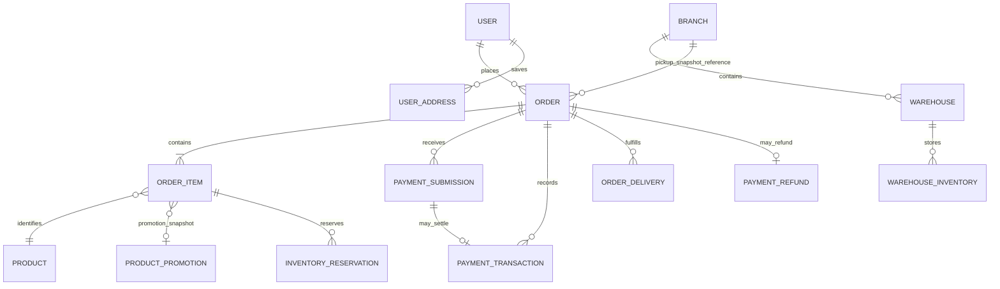

# Auditoría de configuración del negocio y documentos de venta

## Alcance y evidencia

Auditoría estática del código y las migraciones de `main` en `3f40a1a482d1a6b984eb985f77e3969c299d7b1a`. No se editaron archivos de aplicación ni se ejecutaron migraciones, seeders o procesos mutantes. `migrate:status` se consultó en modo lectura y reportó como ejecutadas las migraciones disponibles hasta `2026_11_18_070000_allow_multiple_payment_submissions_per_order`. La conexión efectiva del proceso Laravel consultado fue MySQL 8.4.3, InnoDB, base local `lubricantes`. No se consultaron filas de clientes, pedidos, pagos ni cuentas; por ello este informe no certifica qué datos empresariales están efectivamente configurados en la base.

El estado aplicado informado corresponde a esa conexión local de CLI. No demuestra que un proceso web, otra instalación o producción use la misma conexión.

### Referencias de código principales

- Configuración general: `config/app.php:18,57,72`; moneda e integración remota: `config/payment.php:20,33-41`.
- Configuración de pago y cuenta receptora: `app/Models/PaymentSetting.php:10-50`; `app/Models/PaymentReceivingAccount.php:9-18`.
- Sedes/almacenes: `app/Models/Branch.php:8-20`, `app/Models/Warehouse.php:8-20`; estructura inicial en `database/migrations/2026_07_31_070100_create_branches_table.php:10-21` y `2026_07_31_070110_create_warehouses_table.php:10-20`.
- Comprador/dirección: `app/Models/User.php:11-32`; `app/Models/UserAddress.php:9-20`; `database/migrations/2014_10_12_000000_create_users_table.php:16-24` y `database/migrations/2026_08_03_070370_create_user_addresses_table.php:11-31`.
- Pedido: `app/Http/Controllers/Api/V1/OrderController.php:125-376`; snapshots de seguimiento en `app/Http/Controllers/Api/V1/OrderTrackingController.php:59-112`; líneas en `app/Models/OrderItem.php:14-39`.
- Precio/oferta: `app/Services/ProductPricingService.php:9-33`; `app/Http/Controllers/Api/V1/Admin/ProductPromotionController.php:82-145`; `app/Http/Controllers/Api/V1/OrderController.php:225-376`; migraciones `2026_11_17_071000_create_product_promotions_table.php:9-23` y `2026_11_17_071010_add_promotion_snapshots_to_order_items_table.php:10-40`.
- Abonos y límites: `app/Support/TransferPaymentInstallments.php:37-120`; esquema/migración nueva `database/migrations/2026_11_18_070000_allow_multiple_payment_submissions_per_order.php:10-89`; endpoints cliente/Treasury en `routes/api.php:80-121`.
- Evidencia de entrega: `app/Http/Controllers/Api/V1/Admin/OrderDeliveryController.php:104-125` y `database/migrations/2026_08_01_070270_create_order_deliveries_table.php:64-70`.
- La búsqueda estática de términos tributarios/documentales no encontró RUC, razón social del emisor, documentos de venta, generador PDF tributario ni SUNAT en `app/`, `routes/`, `database/migrations/`, `composer.json` o `package.json`. Como contexto, las rutas de sitemap/web y pagos son distintas de un endpoint de emisión: `routes/web.php:196`, `routes/api.php:108-121`.

## 1. Resumen del sistema encontrado

La instalación representa una sola tienda por base de datos, con varias sedes (`branches`) y almacenes (`warehouses`). No se encontró una entidad independiente `Business`, `Company` o perfil fiscal vendedor. La configuración actual del vendedor está fragmentada entre variables globales (`APP_NAME`, `APP_URL`, timezone), opciones de pago y cuentas receptoras. El titular de una cuenta de cobro es un dato del canal receptor, no una identidad legal validada del vendedor.

El sistema ya dispone de catálogo con marca, modelo comercial y promociones por producto; pedidos con snapshots de sus líneas e importes; reservas e inventario; pagos por pasarela y pagos manuales; abonos múltiples con revisión de Tesorería; preparación, entrega y recojo. El pedido es la entidad comercial central; no se encontró una entidad `Sale` separada.

## Implementación de Etapa A — 2026-11-18

En la rama `feature/business-profile` se implementó una ficha global opcional por instalación en `business_profiles`. Una clave singleton con índice único y una escritura transaccional `insertOrIgnore` seguida de bloqueo de fila cubren la creación concurrente; una instalación migrada puede permanecer sin fila y el GET entrega un perfil nulo más valores iniciales y campos pendientes. Sedes y almacenes siguen siendo entidades operativas independientes y no se añadió una relación sin responsabilidad concreta.

La API administrativa es `GET/PUT /api/v1/admin/business-profile`, protegida por autenticación, cuenta activa y rol administrador tanto en middleware como en FormRequest. El Resource tiene allowlist y devuelve solo URL pública del logo, nunca su ruta. El formulario agrupa identidad, dirección/contacto, logo y moneda/zona horaria de consulta. Perú/RUC son los valores iniciales; el RUC se conserva como texto y se valida localmente (estructura y dígito verificador), sin consulta SUNAT. La moneda continúa viniendo de `config/payment.php` y la zona de `config/app.php`; la pantalla indica ambos orígenes.

Los logos admiten JPEG/PNG/WebP hasta 2 MB y límites de dimensión coherentes con `config/brand_images.php`; se verifica MIME real, se genera UUID bajo `business/logos/`, se procesa sin recorte y se conserva transparencia cuando el formato/procesador lo permite. El disco es `public`; la API entrega su URL mediante el disco `public`. Reemplazo/retiro actualizan la referencia en transacción y limpian después del commit solo rutas UUID bajo ese directorio si ya no están referenciadas. Los errores antes o durante la transacción no alteran la referencia anterior; ante duda se prefiere un archivo huérfano a borrar uno referido.

La auditoría registra una acción propia y únicamente los nombres allowlisted de campos modificados; no conserva valores fiscales, archivo ni ruta. La emisión de documentos, snapshots de emisor por documento, datos tributarios del comprador, impuestos y SUNAT siguen fuera de esta etapa. Los puntos futuros de marca pública incluyen encabezado, pie, correos y metadata; los pedidos históricos no reciben snapshots retroactivos.

## Etapa de solicitud de comprobante — 2026-11-19

Se añadió una configuración por instalación en `business_profiles`: boleta habilitada inicialmente, factura deshabilitada y boleta como tipo inicial. La pantalla administrativa explica que habilitar permite solicitar el documento, no emitirlo. La API rechaza dejar ambos tipos apagados o seleccionar un tipo inicial deshabilitado. `SalesReceiptRules` es la fuente única del contrato público y de la validación del checkout; su versión detecta cambios mientras el formulario permanece abierto.

La creación de pedidos captura en columnas nullable `orders.requested_*` una copia de la solicitud dentro de la transacción del pedido, líneas y reservas. Estas columnas describen el documento **solicitado**, nunca uno emitido. Los pedidos históricos conservan `NULL`; no se realizó backfill. El mismo `checkout_token` retorna el pedido existente sin sobrescribir la copia original. Dirección tributaria se mantiene separada de `shipping_info`.

Reglas locales implementadas: boleta puede llevar identidad voluntaria; el servidor la exige cuando el total final recalculado (productos, descuento y envío) excede estrictamente S/ 700.00. Se aceptan DNI (8 dígitos), RUC (11), carné de extranjería y pasaporte como texto; se exige nombre con identidad. Factura exige RUC de 11 dígitos, receptor y dirección de facturación. El correo de entrega se conserva para ambas solicitudes. La validación solo comprueba formato/longitud; no consulta SUNAT ni RENIEC. El alcance no cubre el supuesto de persona no domiciliada sin documento de identidad admitido.

Consulta de Facturación vive en `/api/v1/billing/orders` y `/api/v1/billing/orders/{id}`. `admin` y `billing` comparten únicamente permiso de consulta mediante `can_access_billing`; el grupo no incluye acciones de pago, configuración o emisión. La bandeja pagina, selecciona columnas y no filtra por estado de pago, por lo que conserva pedidos pendientes y con abonos parciales. El tracking muestra la solicitud solo en el endpoint autenticado y limitado al propietario; no se añadió a enlaces públicos.

### Fuentes SUNAT consultadas el 2026-11-19

- [SUNAT: Boleta de venta](https://orientacion.sunat.gob.pe/03-boleta-de-venta): identifica los datos del adquirente solicitados y el umbral de S/ 700.
- [SUNAT: Reglamento de comprobantes, capítulo III](https://www.sunat.gob.pe/legislacion/comprob/regla/capituloIII.pdf): reglas de emisión de boletas y datos de identificación.
- [SUNAT: Factura electrónica](https://cpe.sunat.gob.pe/tipos_de_comprobantes/factura): factura a favor de adquirente identificado con RUC.
- [SUNAT: Catálogo N.º 06 de tipo de documento](https://www.sunat.gob.pe/legislacion/superin/2021/anexo-026-2021.pdf): catálogo de identidad usado como referencia para DNI, carné de extranjería, RUC y pasaporte.

Esta implementación no es software de emisión tributaria ni acredita la identidad del comprador. Antes de producir documentos reales, debe añadirse el flujo de emisión y revisar sus casos tributarios, incluidas excepciones de no domiciliados y las reglas vigentes en la fecha de emisión.

Validación inicial de la etapa: PHPUnit de perfil 8/74, migración SQLite aislada 1/11, contrato frontend 1/19, `AuditSecurityTraceTest` 29/404 y `AdminAuditLogViewerTest` 22/236; lint PHP aprobado y build Vite 779 módulos. La migración se probó en una conexión SQLite `:memory:` con instalación, rollback y reaplicación, sin tocar la conexión normal `lubricantes`. En esa primera revisión, la validación visual autenticada quedó pendiente. Pint no terminó porque no pudo escribir `app/Support/AuditEventContract.php`; no se modificaron permisos. El modo `--test` detectó asuntos de line endings y espacios en archivos existentes.

### Validación complementaria de comprobantes y rol Facturación — 2026-11-19

La migración `2026_11_19_070000_add_receipt_settings_and_order_request_snapshots` se validó en MySQL 8.4.3/InnoDB, exclusivamente en la base desechable `lubristore_business_profile_validation_20261119_8f2c7a` (host `127.0.0.1`, puerto `3306`). El upgrade partió de tablas preexistentes `business_profiles` y `orders`, conservó el perfil y el pedido históricos, mantuvo los nuevos snapshots en `NULL`, y aplicó los defaults `boleta_enabled=1`, `factura_enabled=0`, `default_receipt_type=boleta`. El rollback eliminó únicamente las columnas añadidas; perfil, pedido, total y rol de usuario permanecieron. Se reaplicó la migración y se verificó actualización de configuración y snapshot.

La columna real `users.role` en MySQL es `varchar(255)` y acepta `billing`. `ReceiptBillingTest` ejecutada con `phpunit.business-profile.validation.mysql.xml` aprobó 11 pruebas/94 assertions después de la reaplicación. La cobertura incluye la asignación administrativa del rol, acceso de admin/Facturación al listado y detalle, rechazo de Tesorería, cliente y cuenta inactiva, boleta en S/ 700.00 y S/ 700.01, identidad voluntaria, total recalculado con envío que supera el umbral, factura con receptor y domicilio fiscal distintos del envío, conflicto cuando cambia la configuración, reintento idempotente que conserva el snapshot y seguimiento privado al propietario.

La instancia visual aislada se abrió en `http://127.0.0.1:8012`, con la misma base desechable. Se confirmó que carga el shell de inicio de sesión y que el acceso sintético de administrador redirige al inicio. No se completó la inspección visual de checkout, configuración ni bandeja en escritorio/móvil: el aviso integrado del gestor de contraseñas de Chrome quedó sobre la interfaz y la automatización no lo descartó ni cambió sus opciones. Esas pantallas requieren revisión manual autenticada en el entorno QA. El servidor local de QA quedó disponible en el puerto 8012; no representa la base normal `lubricantes` ni producción.

## 2. Matriz de capacidades

| Capacidad | Estado | Evidencia/resumen |
|---|---|---|
| Identidad fiscal global del vendedor | Ausente | No se encontró modelo/tabla/campo RUC, razón social o domicilio fiscal del negocio. `config/app.php` contiene nombre, URL y timezone de aplicación, no una ficha fiscal. |
| Configuración de cobro | Existente | `payment_settings` y `payment_receiving_accounts`; son datos operativos de pago. |
| Sedes y almacenes | Existente | `branches` tiene código, nombre, dirección, contacto y opciones de pickup; `warehouses` pertenece a una sede. |
| Datos tributarios del comprador | Ausente | Usuario/dirección no recogen tipo/número de documento ni elección boleta/factura. |
| Snapshot de envío/recojo | Existente | `orders` conserva información operativa de dirección y sede; no equivale a snapshot tributario de comprador/emisor. |
| Precio histórico de la línea | Existente | `order_items.price`, `regular_price`, `promotion_id`, `subtotal`, `product_name`; la migración promocional permite datos nullable para historia anterior. |
| Impuestos/afectación tributaria | Ausente | No se encontró tasa, base imponible, IGV, tipo de afectación ni desglose tributario persistido. No se puede afirmar si los precios incluyen impuesto. |
| Abonos múltiples y conciliación | Existente | `payment_submissions` permite varias operaciones por pedido; el importe declarado es nullable para compatibilidad histórica. |
| Documento fiscal generado por la tienda | Ausente | No se encontró motor/tablas de boleta, factura, notas de crédito/débito o emisión SUNAT. |
| Adjuntar comprobante externo de venta | Ausente | No se encontró módulo de registro de documentos externos emitidos por otro sistema. |
| Facturación electrónica | Ausente | No se encontró cliente/proveedor SUNAT, firma, XML tributario, CDR ni dependencia generadora de comprobantes. |
| Evidencia de pago del cliente | Existente, distinta | `PaymentSubmission` representa datos reportados del abono y revisión de Tesorería; no es boleta/factura emitida por LubriStore. |
| Evidencia de entrega | Existente | Delivery maneja evidencia operativa de entrega; no es documento tributario de venta. |

## 3. Mapa de relaciones actual

`payment_submissions` conserva `order_id`; desde la migración del 18 de noviembre ya no es único y `amount` es nullable. La relación a `orders` continúa protegida contra borrado. Una transacción financiera aprobada se vincula a la presentación correspondiente cuando aplica. Las relaciones de inventario conectan pedido/línea con reserva, almacén, saldo y movimientos.

## 4. Datos disponibles y faltantes

| Dominio | Datos actuales | Faltantes/alcance |
|---|---|---|
| Aplicación/negocio | `APP_NAME`, `APP_URL`, `APP_TIMEZONE`; moneda de pago configurada como PEN | Razón social, RUC, nombre comercial separado, logo empresarial, domicilio fiscal, correo/teléfono del emisor, código de establecimiento fiscal. |
| Cuenta de cobro | Canal, nombre visible, `holder_name`, moneda, banco/cuenta/CCI/teléfono, QR; secretos/datos sensibles protegidos según modelo/configuración | No se valida que `holder_name` sea la razón social o titular tributario. No debe copiarse automáticamente como emisor. |
| Sede | Código, nombre, descripción, dirección, territorio, teléfono, correo, horario e instrucciones de pickup, flags de actividad/servicio | No existe código tributario de establecimiento ni vínculo con un emisor fiscal. |
| Almacén | Código, nombre, dirección, sede, default/activo | Es ubicación logística; no necesariamente domicilio de emisión o despacho tributario. |
| Usuario/comprador | Nombre, email, teléfono, rol/estado; dirección con destinatario, teléfono, domicilio y ubicación | DNI/RUC, tipo de documento, razón social, domicilio de facturación y selección de tipo de comprobante. |
| Pedido | Usuario nullable por compatibilidad, modalidad, estado, totales, moneda implícita de pago PEN, snapshots de envío y pickup | No guarda snapshot fiscal de emisor/receptor, tipo/serie/número de comprobante ni afectación/impuesto calculado. El checkout actual exige usuario autenticado; no se observó un flujo operativo de invitado. |
| Línea | Producto, snapshot de nombre, cantidad, precio aplicado, subtotal; desde noviembre, precio regular y referencia nullable de promoción | SKU/modelo no se identificaron como snapshot tributario garantizado en la estructura actual de `order_items`; debe verificarse antes de emitir documentos históricos. |

Los datos del perfil actual no son una fuente histórica segura para una futura factura: pueden cambiar. Las direcciones de entrega sí se snapshottean en el pedido, pero no deben interpretarse automáticamente como domicilio fiscal del comprador.

## 5. Flujo actual de pedido, cobro, inventario y entrega

1. El cliente autenticado prepara carrito y checkout. El servidor recalcula precios y envío, valida modalidad/dirección o sede, crea el pedido y líneas dentro de transacción y reserva stock. `checkout_token` protege la idempotencia de creación.
2. Una promoción activa por producto produce precio aplicado; el pedido conserva precio normal, precio aplicado, subtotal y referencia de promoción en cada línea. Si el precio cambia antes de crear el pedido, se pide confirmación del importe recalculado. Una vez creado, el pedido conserva el importe snapshot aunque la oferta expire o cambie el catálogo.
3. Para transferencia/Yape/Plin, el cliente puede registrar varias presentaciones de abono bajo límites definidos por el total. Tesorería revisa cada una. El pago del pedido se marca aprobado al quedar cubierto el total aprobado conforme al servicio; el consumo de inventario y movimiento de venta son idempotentes.
4. Mercado Pago conserva preferencias/transacciones/webhooks y el procesamiento es idempotente. Contraentrega y pago en sede se registran por los flujos operativos de cobro correspondientes.
5. El fulfillment, picking/packing, delivery y pickup mantienen entidades y estados propios. La entrega no se convierte por sí sola en una factura.
6. Cancelaciones/reembolsos usan servicios de devolución y movimientos de inventario según el estado. El modelo actual de reembolso general admite flujos internos/HTTP de Tesorería; la emisión tributaria de nota de crédito no está implementada.

El evento de venta reconocido por reportes está ligado al pago y sus timestamps, pero no hay entidad fiscal de venta emitida. Los valores decimales se calculan con utilidades monetarias y precisión de dos decimales; no se encontró cálculo tributario explícito.

## 6. Documentos e integraciones reales

| Evidencia | Propósito actual | No representa |
|---|---|---|
| Pedido, detalle e historial | Confirmación y seguimiento operativo/comercial | Factura/boleta con serie tributaria. |
| `PaymentSubmission` e historial | Declaración y revisión de abono por el cliente/Tesorería | Comprobante de venta del negocio. |
| Preferencia, transacción y evento de webhook | Integración/conciliación de cobro | Documento tributario. |
| Evidencia de delivery | Constancia logística de entrega | Guía de remisión fiscal ni comprobante de pago. |
| Sitemap, metadata SEO, imágenes | Publicación web y archivos del catálogo | Sistema de documentos de venta. |

Mercado Pago está integrado mediante configuración y gateway. Se encontraron claves por nombre de variable en `config/payment.php`, sin exponer sus valores. No se identificó integración SUNAT, consulta RUC/DNI ni proveedor de facturación. Tampoco se encontró dependencia de generación de PDF tributario. La presencia de vistas HTML o archivos de evidencia logística no prueba capacidad de emisión fiscal.

## 7. Brechas por etapas

### Etapa A — Configuración del negocio

- **Resuelve:** una ficha coherente del emisor global de esta instalación.
- **Reutiliza:** `branches`, `warehouses`, `PaymentSetting` y cuentas receptoras, cada una con su responsabilidad actual.
- **Propuesta:** singleton `business_profile` (o tabla `business_settings` con una fila única) con razón social, nombre comercial, RUC, país, dirección fiscal, email/teléfono, logo/ruta, zona horaria y moneda explícitas. La unicidad del registro debe hacerse cumplir en DB; secretos externos separados/cifrados.
- **Sedes:** relacionar establecimientos tributarios por `branch_id` solo si el contador confirma que cada sede debe tener código/domicilio propio. No replicar datos del negocio en cada almacén.
- **Permisos/UI:** edición solo por administrador activo autorizado; la ficha no se vuelve pública por defecto. Presentarla en documentos mediante snapshots.
- **Histórico:** actualizar la ficha no debe cambiar documentos ya emitidos.

### Etapa B — Documentos comerciales generados

- **Resuelve:** representación durable del pedido y, tras definición contable, generación de documento no tributario o comprobante con datos completos.
- **Reutiliza:** `orders`, `order_items`, snapshots de precios/ofertas, envío/recojo y estado financiero.
- **Propuesta mínima si el negocio decide empezar con documentos internos:** `sales_documents` con tipo, estado, número interno, `order_id`, fecha, totales, snapshot de emisor/receptor y archivos privados; `sales_document_items` con producto/descrición/cantidad/precios. No llamarlo factura fiscal hasta contar con serie/numeración y reglas oficiales aprobadas.
- **Pedido con varios abonos:** el documento puede vincularse al pedido; abonos previos no crean automáticamente un comprobante separado.
- **Agrupar pedidos:** no recomendado inicialmente; si se requiere, pivot `sales_document_orders` en lugar de `order_id` único.

### Etapa C — Registro de documentos externos

- **Resuelve:** asociar boleta/factura/nota emitida por SUNAT u otro sistema externo al pedido y a los abonos relevantes.
- **Propuesta:** cabecera `sales_documents` con `issuer_profile_snapshot`, receptor snapshot, `document_type`, serie/número, emisión/vencimiento, moneda, base/impuestos/totales, estado, origen (`external`/`internal`), referencia externa e idempotencia; líneas snapshot; tabla de archivos privados por tipo (PDF/XML/CDR/representación), hash, tamaño, MIME real, owner y estado de validación.
- **Relaciones:** `sales_document_orders` permite un documento asociado a varios pedidos; `sales_document_payments` vincula múltiples abonos/transacciones y soporta pagos anticipados. Restricciones únicas por emisor/tipo/serie/número según regla aprobada.
- **Devoluciones:** tabla de relación para nota de crédito hacia documento original y reembolso(s); no asumir equivalencia uno-a-uno. Parciales requieren líneas/cantidades/importes aplicados y saldo por documento.
- **Seguridad:** archivos privados, descargas autorizadas, audit trail allowlisted, integridad hash; reemplazos versionados, no sobreescribir evidencia emitida.

### Etapa D — Emisión electrónica futura

- **Resuelve:** emisión autorizada, envío, consulta de estado y recuperación de errores con proveedor.
- **Reutiliza:** documentos/snapshots de B/C; adaptador de proveedor, outbox/job idempotente, credenciales cifradas y callback autenticado.
- **No asumir:** formato SUNAT, aceptación de contingencias, tipos de documento, impuestos o reglas de notas. Validar con fuentes oficiales peruanas y responsable contable antes de modelar el contrato final.

## 8. Decisiones que requiere el propietario/contador

1. ¿La primera entrega emitirá comprobantes tributarios o solo conservará pedidos/constancias internas?
2. ¿Qué tipos de receptor se admitirán (persona natural, RUC empresa) y qué campos son obligatorios para boleta/factura?
3. ¿El negocio tiene una sola entidad/RUC con establecimientos por sede o varias razones sociales dentro de una instalación?
4. ¿Los precios del catálogo se consideran con IGV incluido? ¿Qué afectaciones, exoneraciones o inafectaciones aplican por producto?
5. ¿En qué momento se debe emitir: pedido creado, primer abono, pago completo, despacho o entrega? ¿Qué pasa con anticipos?
6. ¿Un comprobante puede cubrir varios pedidos, y un pedido puede dividirse en varios comprobantes?
7. ¿Cómo se documentan devoluciones parciales, varios abonos reembolsados y sustitución/anulación de documentos?
8. ¿Qué proveedor, credenciales, ambiente, firma y política de contingencia se usarán para una fase electrónica?

## 9. Riesgos e incompatibilidades

- **P1 — Sin identidad fiscal:** no es posible generar un documento fiscal consistente desde la configuración actual.
- **P1 — Sin snapshot tributario de comprador/emisor:** editar perfil, sede o configuración alteraría la fuente de una emisión futura si se consulta en vivo.
- **P1 — Sin motor tributario:** el total del pedido no proporciona base imponible, impuesto, afectación ni redondeos tributarios.
- **P2 — Ambigüedad de “comprobante”:** el código de pagos y la UI usan comprobante/evidencia para la presentación del cliente; la nueva documentación debe usar “abono reportado” para ese objeto y “comprobante de venta” para el emitido por el negocio.
- **P2 — Multiplicidad:** pagos ahora son uno-a-muchos por pedido; una cabecera de documento ligada a un único abono/pedido no cubriría anticipos, pagos agregados ni notas parciales.
- **P2 — Sede logística ≠ establecimiento fiscal:** `Branch` no tiene identificador tributario de establecimiento; no inferirlo de `code`.

## 10. Archivos relevantes

- Configuración global: `config/app.php`, `config/payment.php`, `config/filesystems.php`.
- Negocio operativo: `app/Models/Branch.php`, `app/Models/Warehouse.php`, `database/migrations/2026_07_31_070100_create_branches_table.php`, `2026_07_31_070110_create_warehouses_table.php`.
- Cobros: `app/Models/PaymentSetting.php`, `PaymentReceivingAccount.php`, `PaymentSubmission.php`, `PaymentTransaction.php`, `PaymentRefund.php`; sus migraciones `2026_08_03_070430`, `2026_09_08_070540`, `2026_09_08_070560`, `2026_11_18_070000`.
- Comprador/dirección: `app/Models/User.php`, `app/Models/UserAddress.php`, `app/Http/Controllers/Api/V1/ProfileController.php`, `OrderController.php`.
- Pedido/venta: `app/Models/Order.php`, `OrderItem.php`, `app/Http/Controllers/Api/V1/OrderController.php`, `OrderTrackingController.php`.
- Precios: `app/Services/ProductPricingService.php`, `CheckoutPriceConfirmationService.php`, `ProductPromotion.php`, `database/migrations/2026_11_17_071000_create_product_promotions_table.php`, `2026_11_17_071010_add_promotion_snapshots_to_order_items_table.php`.
- Abonos: `app/Support/TransferPaymentInstallments.php`, `CustomerPaymentSubmissionService.php`, `TreasuryPaymentApprovalService.php`.
- Rutas de pagos y reembolsos: `routes/api.php`; interfaz Treasury: `resources/js/views/treasury/TreasuryPayments.vue` y `TreasuryRefunds.vue`.

## Estado de validación

La conclusión de esta auditoría es estática salvo la consulta de estado de migraciones y metadatos de conexión descritos al inicio. No se inspeccionaron datos empresariales locales ni se verificó la configuración efectiva del proceso web. No se emitió, registró o modificó documento alguno; el informe es una base para decidir el prompt de implementación.
