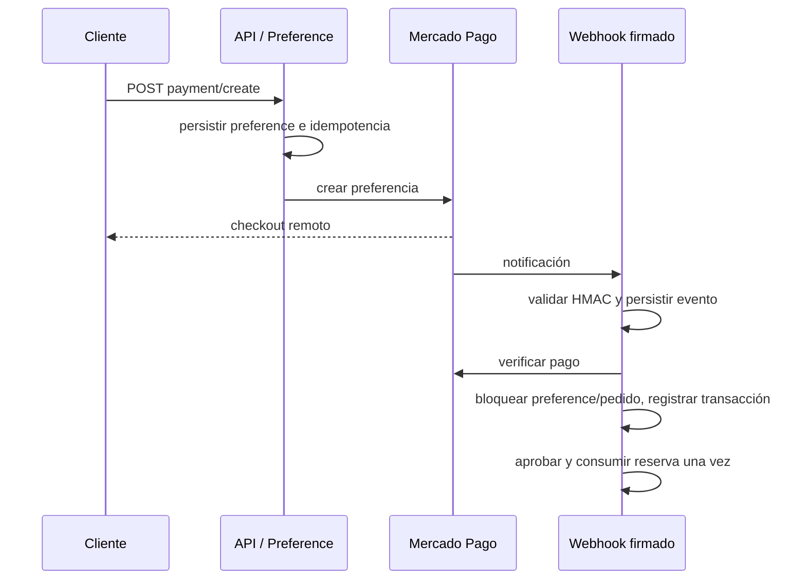
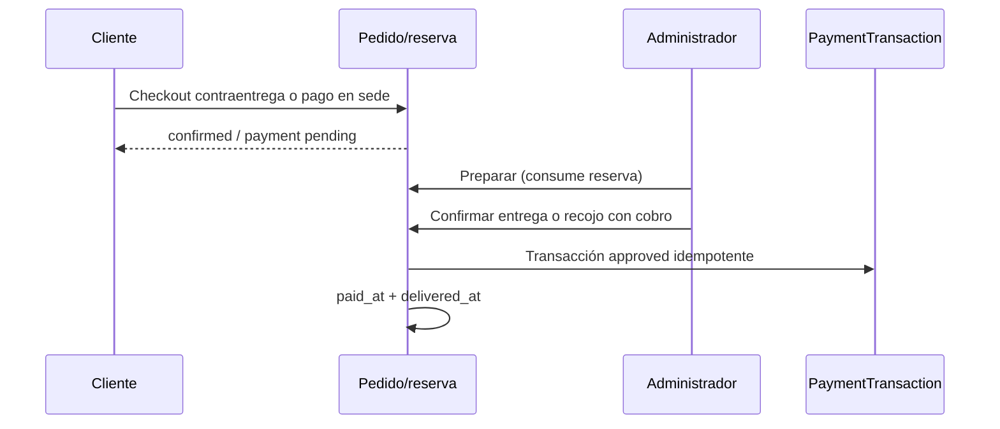
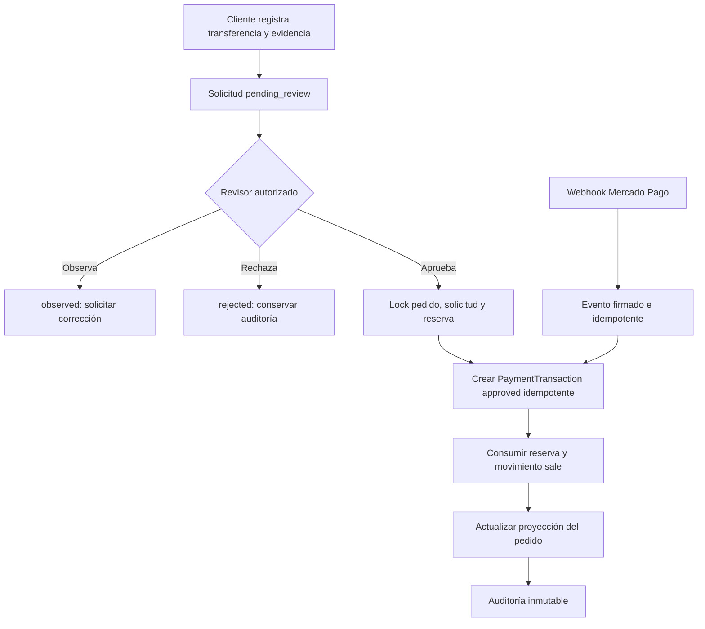

# Auditoría del flujo de pagos y Tesorería

> **Precedencia documental — dd2436b, consolidado el 2026-10-18:** las secciones de cierre más recientes sustituyen límites históricos incompatibles. Se conserva el historial útil, pero las ausencias y propuestas del diagnóstico inicial no describen el estado vigente. Esta consolidación no ejecutó pruebas ni consultó bases de datos.

> **Actualización posterior del 2026-10-18:** A0/A1/A2 quedaron versionados localmente en `d0a73e2`. El cierre B3-B al final registra la capa HTTP privada y su certificación local, y sustituye los pendientes históricos de finalización interna y exposición HTTP. B3-B continúa sin commit ni despliegue nuevo; dd2436b sigue siendo la referencia de Hostinger confirmada.

## Resumen ejecutivo

Yape, Plin y banco siguen siendo `orders.payment_method=transferencia` y se distinguen por canal (`yape`, `plin`, `bank_transfer`). 2B1/2B2/2B3 están cerradas: presentación y recuperación del cliente, bandeja Treasury, observación, rechazo, corrección y aprobación financiera atómica. El importe esperado proviene exclusivamente de `orders.total`; no hay pagos parciales ni cuotas.

LubriStore tiene cuatro valores comerciales de método de pago: `card`, `transferencia`, `contra_entrega` y `pago_en_sede`. Mercado Pago conserva preferencias, transacciones y webhooks; contraentrega/pago en sede generan una `PaymentTransaction` al confirmarse el cobro. La aprobación Treasury vincula presentación, transacción e historial y consume inventario una sola vez. El flujo operativo legacy permanece para pedidos sin presentación; ante una presentación responde `treasury_approval_required`.

Existen roles `admin`, `customer` y `treasury`. `active_user` bloquea usuarios inactivos; `is_treasury` protege la bandeja financiera. Las cuentas receptoras siguen bajo administración. 2B4-B1/B2 están implementados y certificados, con apertura de resolución, reasignación/aprobación, HTTP, Vue y tracking de la reserva actual. B3-A0/A1/A2 aportan el backend interno de reembolso total, versionado en `d0a73e2`. B3-B añade HTTP privado certificado localmente; el frontend Treasury de reembolsos, la integración de devolución con gateways y la operación productiva siguen pendientes.

Esta auditoría es de lectura: se inspeccionaron rutas, código, migraciones, modelos y pruebas. No se invocaron endpoints mutantes, pagos, webhooks, migraciones, seeders ni base de datos comercial.

## Situación actual y métodos admitidos

> **Corte histórico inicial:** los apartados comprendidos desde aquí hasta la conclusión histórica conservan el diagnóstico previo a los cierres de Tesorería. Sus afirmaciones de ausencia y propuestas quedan sustituidas cuando resultan incompatibles con los cierres posteriores.

`app/Http/Controllers/Api/V1/OrderController.php::store` valida exactamente:

| Valor persistido en `orders.payment_method` | Modalidad compatible | Fuente pública |
|---|---|---|
| `card` | delivery o pickup | Tarjeta; gateway activo `mock` o Mercado Pago |
| `transferencia` | delivery o pickup | Transferencia bancaria / Yape / Plin |
| `contra_entrega` | solo delivery | Cobro al confirmar entrega |
| `pago_en_sede` | solo pickup | Cobro al registrar recojo |

Yape y Plin **no son métodos independientes**. `PaymentSetting` guarda teléfonos en `transfer_yape_phone` y `transfer_plin_phone`; `PaymentSettingService::getPublicMethods()` los expone como billeteras dentro del único método `transferencia`. No existe `payment_method=yape` ni `payment_method=plin`.

El gateway `mock` es una configuración de tarjeta para pruebas, no un valor de `payment_method`. El webhook mock heredado solo se permite en entorno `testing` cuando se configura expresamente; el tráfico de Mercado Pago usa la ruta firmada.

## Inventario técnico

### `orders`

Modelo: `app/Models/Order.php`. Tabla creada en `2026_01_18_203611_create_orders_table.php` y ampliada por migraciones posteriores.

| Grupo | Campos relevantes |
|---|---|
| Comercial | `status`, `subtotal`, `discount_total`, `shipping_amount`, `total`, `payment_method`, `payment_status` |
| Pago | `payment_id`, `current_payment_preference_id`, `payment_data`, `paid_at` |
| Reserva | `reserved_until`; relación `reservations` |
| Entrega | `delivery_type`, `pickup_branch_id` y snapshots de recojo/envío, `tracking_status`, `fulfillment_status`, `delivered_at` |
| Auditoría operativa | `prepared_by`, `ready_by`, `delivered_by`, timestamps Eloquent |

`payment_status` nació como enum: `pending`, `approved`, `rejected`, `refunded`. El servicio también trata `in_process` como `pending`; Mercado Pago conserva su estado remoto en `PaymentTransaction.provider_status`, no en este campo. `status` comercial admite `pending`, `confirmed`, `shipped`, `delivered`, `canceled`, `rejected` en `OrderStateService`.

Faltan en `orders` los datos suficientes para comprobar una transferencia: operación declarada, fecha declarada, cuenta receptora, evidencia, aprobador/rechazador y motivo de decisión. `payment_data` es JSON, pero no hay flujo que los solicite ni contrato que lo normalice.

### `payment_transactions`

Modelo: `app/Models/PaymentTransaction.php`; migraciones `2026_08_01_070260_create_payment_transactions_table.php` y `2026_09_04_070510_add_gateway_fields_to_payment_transactions_table.php`.

| Campo/grupo | Uso actual |
|---|---|
| Identidad | `order_id` con `restrictOnDelete`, `gateway`, `payment_method`, `transaction_type` (`payment`/`refund`) |
| Resultado | `status` (`pending`, `approved`, `failed`, `canceled`), `amount`, `currency` |
| Idempotencia | `idempotency_key` UNIQUE, `approved_scope_key` UNIQUE nullable, UNIQUE `(gateway, provider_payment_id)` |
| Proveedor | `external_reference`, `provider_payment_id`, `payment_preference_id`, `provider_status`, `provider_status_detail`, `verified_at` |
| Cobro manual | `manual_reference`, `collection_method`, `collected_by`, `collected_at`, `confirmed_by`, `confirmed_at` |
| Fallo | `failed_at`, `failure_reason`, `metadata` |

Índices adicionales: `(order_id,status)` y `(payment_method,transaction_type,status)`. El modelo bloquea `update` y `delete`, por lo que una transacción confirmada es inmutable. La tabla puede registrar referencia manual y aprobador para contraentrega/pago en sede, pero **la aprobación de transferencia vigente no la usa**. Tampoco contiene enlace de comprobante o evidencia.

### `payment_preferences`

Modelo: `PaymentPreference`; migración `2026_09_04_070500_create_payment_preferences_table.php`.

Estados: `creating`, `active`, `superseded`, `failed`, `orphaned`. Tiene `order_id` restrictivo, `provider_preference_id` UNIQUE, `external_reference` UNIQUE, `idempotency_key` UNIQUE y una columna generada `active_order_id` que fuerza una preferencia `creating`/`active` por pedido. Guarda URLs de checkout y fechas de inicio, activación, fallo o sustitución.

### `payment_webhook_events`

Modelo: `PaymentWebhookEvent`; migración `2026_09_04_070520_create_payment_webhook_events_table.php`.

Estados: `received`, `processing`, `processed`, `ignored`, `failed`. Registra gateway, identificadores remotos, hash de payload y request, `idempotency_key` UNIQUE, motivo de fallo y tiempos de recepción/proceso. Índice `(gateway,provider_payment_id)`. No persiste el payload completo, una decisión adecuada para reducir exposición; por ello no sirve como comprobante de transferencia manual.

### `payment_settings`

Modelo: `PaymentSetting`; migración `2026_08_03_070430_create_payment_settings_table.php`. Es configuración singleton por convención (`firstOrCreate`), sin índice único explícito que lo garantice. Define habilitación, títulos e instrucciones de tarjeta, transferencia/Yape/Plin, contraentrega y pago en sede. El token de Mercado Pago usa cast `encrypted` y está oculto; los datos de cuenta/billetera sí son configuración administrativa, no evidencia de un pago.

### Reservas, inventario y evidencia

`inventory_reservations` tiene una fila por `order_item_id` (UNIQUE), `idempotency_key` UNIQUE, estados `active`, `consumed`, `released`, `expired`, tiempos de expiración/consumo/liberación e índices por estado, pedido y producto-almacén. `warehouse_inventories.reserved_quantity` mantiene el saldo comprometido. `InventoryMovement` es inmutable y usa `idempotency_key` UNIQUE; ventas consumidas generan `sale`, devoluciones por cancelación `cancellation_return`.

No se localizó una tabla ni endpoint de comprobantes de transferencia. Las evidencias existentes pertenecen a entrega (`order_delivery_attempts` y almacenamiento de evidencia de delivery), no a pagos.

## Flujos actuales por método

### Creación común del pedido

`POST /api/v1/orders` exige usuario autenticado. `OrderController::store` valida método, modalidad, dirección o sede, recalcula precios desde `Product`, vuelve a cotizar delivery y toma el almacén principal activo. Crea pedido, items y reserva dentro de una transacción. El token se busca con `checkout_token` **y** `user_id` bajo `lockForUpdate`; un token perteneciente a otro usuario obtiene error de validación.

- Tarjeta y transferencia: `status=pending`, `payment_status=pending`, `tracking_status=pending`, reserva con vencimiento configurable (por defecto 30 minutos).
- Contraentrega y pago en sede: `status=confirmed`, `tracking_status=confirmed`, `payment_status` conserva su default `pending`; la reserva se crea con vencimiento de diez años como compromiso operativo hasta consumirla.
- Delivery calcula y snapshottea tarifa; pickup deja envío en cero y snapshottea sede. Los precios, tarifa y snapshots no llegan confiados desde frontend.

### Transferencia, Yape y Plin

No existe carga de comprobante/archivo en 2B1. Sí existe un paso de cliente que registra una presentación con operación, fecha declarada y cuenta receptora; Yape/Plin se presentan como canales de `transferencia` mediante cuentas receptoras y QR privado.

La única aprobación es `POST /api/v1/admin/orders/{order}/fulfillment/approve-transfer`, llamada desde `resources/js/views/admin/Orders.vue::runAction` al elegir “Aprobar transferencia”. El componente pide confirmación visual, sin payload de referencia, importe, fecha, comprobante u observación.

`OrderFulfillmentController::approveTransfer` delega en `OrderFulfillmentService::approveTransfer`:

1. abre transacción y bloquea `orders` con `lockForUpdate`;
2. exige `payment_method=transferencia`, estado de fulfillment `reserved` y pago aún no aprobado;
3. consume las reservas mediante `InventoryService::consumeOrderReservation`, que bloquea inventario y registra movimientos `sale` de forma idempotente;
4. actualiza `orders.payment_status=approved`, `paid_at`, `status=confirmed`, `tracking_status=confirmed`;
5. devuelve la presentación de fulfillment.

La repetición después de aprobado devuelve el pedido sin volver a consumir inventario. Sin embargo, no genera `PaymentTransaction`, no escribe `OrderFulfillmentHistory`, no registra usuario aprobador ni notifica. La ruta está dentro de `is_admin`: puede ejecutarla cualquier administrador activo.

```mermaid
sequenceDiagram
  participant C as Cliente
  participant O as Pedido/reserva
  participant A as Administrador
  participant F as Fulfillment
  C->>O: Checkout transferencia
  O-->>C: pending / reserva activa
  A->>F: approve-transfer
  F->>F: lockForUpdate pedido
  F->>O: consumir reserva y movimientos sale
  F->>O: payment_status=approved; paid_at; confirmed
  Note over F,O: No PaymentTransaction ni comprobante
```

### Mercado Pago y tarjeta

`POST /api/v1/payment/create` requiere Sanctum y comprueba propiedad del pedido. Solo admite pedidos `card` pagables, no vencidos, no terminales y no aprobados. `PaymentPreferenceService::createFor` persiste primero una preferencia con claves únicas, bloquea el pedido, realiza la llamada remota después de persistir intención y evita reintentos ciegos: un resultado incierto queda `orphaned` para conciliación.

`GET /api/v1/payment/return` requiere propietario, pero es solo informativo: no llama al proveedor, no cambia inventario ni estado. `GET /api/v1/payment/verify/{paymentId}` también exige propietario, pedido y transacción local existente para el gateway/preferencia; procesa una verificación remota bajo las mismas reglas del procesador.

`POST /api/v1/payment/webhook` es público y no usa sesión Sanctum. `PaymentWebhookSignatureService::validate` comprueba la firma HMAC de Mercado Pago con ventana de tolerancia. Después persiste/bloquea `PaymentWebhookEvent` por clave idempotente, consulta al proveedor y busca preferencia por gateway, preferencia externa y referencia externa. `PaymentProcessingService::process` bloquea preferencia y pedido, valida referencia, importe y moneda para gateway real, evita asociar un pago remoto a otro pedido, crea una transacción y aplica estado.

Cuando se aprueba, se registra una `PaymentTransaction` aprobada, se confirma el pedido y se consume una sola vez la reserva. Webhooks repetidos retornan `ok` sin reprocesar; también hay límites por UNIQUE de evento, pago remoto y ámbito aprobado. `rejected` mantiene el pedido pendiente y la reserva activa para reintentar mientras no venza. `refunded`, `charged_back` y `cancelled` generan advertencia y requieren revisión manual; no cancelan ni reponen inventario automáticamente en `PaymentProcessingService`.



### Contraentrega y pago al recoger

Ambos se crean confirmados operativamente pero pendientes de pago. Para poder iniciar preparación, `OrderFulfillmentService::startPreparation` exceptúa estos métodos de la exigencia de pago aprobado y consume la reserva. En pickup, `markAsPickedUp` exige `money_received=true` y `collection_method` (`cash`, `card_terminal`, `bank_transfer` u `other`); invoca `OrderPaymentService::confirmCashOnDeliveryCollection` y luego establece `picked_up_at`, `delivered_at`, `status=delivered` y fulfillment entregado.

Para delivery del flujo vigente, la confirmación logística termina en `OrderDeliveryService` y usa el mismo `OrderPaymentService`; las pruebas muestran que crea una sola transacción, marca pago aprobado y no genera otro movimiento de inventario. El servicio bloquea el pedido y usa claves `cod-collection-order-{id}` y `cod-approved-order-{id}`; conserva cobrador, fecha, confirmador, método y referencia manual opcional.



## Matriz de transiciones demostradas

| Evento | `payment_status` / pedido | Reserva e inventario | Transacción / historial | Acción posterior |
|---|---|---|---|---|
| Crear tarjeta/transferencia | pending / pending | activa, vence | no transacción | pagar o aprobar transferencia |
| Crear COD/pago en sede | pending / confirmed | activa, compromiso largo | no transacción | preparar sin pago aprobado |
| Aprobar transferencia | approved / confirmed | consume; movimiento `sale` | **sin PaymentTransaction**; sin historial financiero | preparar |
| Webhook tarjeta aprobado | approved / confirmed | consume; `sale` idempotente | transacción aprobada + evento procesado | preparar |
| Webhook repetido | sin cambio | sin cambio adicional | evento/UNIQUE evita duplicado | ninguna |
| Webhook rechazado | rejected / pending | reserva sigue activa | intento fallido cuando se procesa | reintentar antes del vencimiento |
| Expirar reserva de tarjeta/transferencia | pedido se cancela cuando se detecta en flujo de expiración | activa → expired; libera reservado; sin `sale` | sin pago financiero nuevo | nuevo checkout |
| Cancelar antes de consumo | canceled | activa → released; físico igual | historial fulfillment; sin movimiento de retorno | terminal |
| Cancelar después de consumo | canceled | consumida; físico repuesto; `cancellation_return` | historial fulfillment | terminal; no reembolso automático |
| Entregar COD/pago en sede | approved / delivered | ya consumida, físico no cambia | transacción aprobada idempotente e historial de delivery/fulfillment | terminal |
| Reembolso, contracargo o `cancelled` remoto | revisión manual; no transición automática fiable | no reposición automática | evento/procesador puede dejar advertencia | intervención financiera manual |

La columna “historial” es operativa (`OrderFulfillmentHistory`, delivery o handling) y no equivale a un libro mayor financiero. La aprobación de transferencia no crea tampoco una fila de este historial desde `approveTransfer`.

## Aprobación manual, responsabilidades y riesgos

`resources/js/views/admin/Orders.vue` combina la vista de pedido, el botón “Aprobar transferencia”, acciones de fulfillment, el panel de picking/packing y delivery. La ruta administrativa está protegida solo por `is_admin`; no hay policy, FormRequest específico, rol de tesorería ni separación entre quien aprueba y quien prepara.

| Hallazgo | Clasificación | Evidencia / impacto |
|---|---|---|
| Preferencias, webhooks y pagos remotos persistentes e idempotentes | Correcto | `PaymentPreferenceService`, `PaymentWebhookEvent`, índices UNIQUE y `PaymentProcessingService` |
| Cobro COD/pago en sede con transacción inmutable e idempotencia | Correcto | `OrderPaymentService::confirmCashOnDeliveryCollection` |
| Preparación bloqueada para tarjeta/transferencia sin aprobación | Correcto | `OrderFulfillmentService::startPreparation` |
| COD/pago en sede puede prepararse antes del cobro | Aceptable para etapa inicial | Política explícita; riesgo comercial normal de contraentrega |
| Yape/Plin agrupados bajo transferencia | Aceptable para etapa inicial | Configuración clara, pero sin conciliación independiente |
| Aprobar transferencia no registra transacción ni aprobador | Bloqueo para producción | No existe evidencia, importe, cuenta, usuario ni auditoría financiera verificable |
| Cualquier admin puede aprobar y preparar | Riesgo alto | `is_admin` binario; no hay segregación de funciones |
| Sin rechazo/observación/reversión de transferencia | Riesgo alto | No hay rutas, servicio ni modelo para esas decisiones |
| Sin comprobante de archivo y sin revisión de Tesorería | Riesgo alto | 2B1 registra operación, fingerprint e historial, pero aún no hay bandeja de observación/rechazo/aprobación |
| Reembolso/contracargo no automatiza stock | Correcto como medida de seguridad, pero incompleto | Requiere política y bandeja manual |
| `orders.payment_data` JSON como posible contenedor informal | Riesgo medio | No tiene esquema, evidencia ni auditoría |

## Capacidades ausentes confirmadas

No se localizó operación para rechazar transferencia, marcar comprobante inválido, solicitar corrección, registrar pago parcial o excedente, revertir aprobación, iniciar reembolso, adjuntar observaciones financieras, almacenar comprobante, detectar duplicados por número de operación o conciliar contra cuenta receptora. Tampoco hay endpoint administrativo de listado de transacciones/eventos de pago; solo existe la configuración `GET/PUT /api/v1/admin/payment-settings`.

## Propuesta: módulo Tesorería

Ruta propuesta: `/admin/treasury/payments`. No debe reemplazar operaciones de fulfillment ni mutar directamente `orders` desde Vue. Debe usar un servicio financiero transaccional que, al aprobar, cree la transacción y aplique la proyección de pedido/reserva en una única unidad atómica.

### Bandejas, filtros y detalle

| Bandeja | Origen | Filtros mínimos | Acciones autorizadas |
|---|---|---|---|
| Pendientes de validación | transferencias con comprobante o declaración | fecha, método, importe, cuenta, pedido, cliente anonimizado | aprobar, rechazar, observar |
| Aprobados | transacciones approved | periodo, método, aprobador, referencia | ver auditoría; no editar |
| Rechazados / observados | decisión financiera persistida | motivo, usuario, periodo | solicitar corrección o reabrir bajo regla explícita |
| Mercado Pago | `PaymentTransaction` + `PaymentWebhookEvent` | provider status, preference, pago remoto, periodo | ver estado; derivar a revisión manual |
| COD / pago en sede | transacciones de cobro manual | recojo/delivery, collector, método de cobro | ver confirmación y referencia |
| Reembolsos / revisión manual | transacciones/eventos de excepción | refunded, charged_back, cancelled, motivo | iniciar proceso controlado, sin reposición automática |

Columnas: pedido, método, estado financiero interno, estado proveedor cuando exista, importe y moneda, referencia, fecha declarada/confirmada, usuario que decidió, evidencia disponible y enlace administrativo seguro. KPIs: pendientes, importe pendiente, aprobados del periodo, rechazados, observados, excepciones remotas y cobros COD pendientes; ninguno debe sumar pedidos duplicados ni datos no aprobados.

El detalle debe separar snapshot del pedido, datos declarados, cuenta receptora snapshot, archivos de evidencia con acceso autorizado, decisión, transacciones inmutables y línea de auditoría. No debe mostrar tokens, payload remoto íntegro ni datos personales ajenos al caso.

### Modelo de permisos recomendado

Actualmente no conviene inventar un rol nuevo en frontend: `users.role` solo tiene `admin`/`customer` y `is_admin` protege todo el bloque. Alternativas ordenadas:

1. **Fase inicial controlada:** capacidad booleana explícita y temporal, por ejemplo `can_manage_treasury`, aplicada por middleware/policy a rutas de Tesorería; requiere migración y auditoría de cambios.
2. **Opción preferida escalable:** tablas de roles/permisos o una matriz de capacidades (`payments.view`, `payments.review`, `payments.approve`, `payments.refund`) con middleware/policies. Permite separar consulta, revisión y aprobación.
3. **Ampliar enum de roles:** posible, pero menos flexible y requiere migración, UI de usuarios, middleware y pruebas de compatibilidad.

Debe impedirse que una persona apruebe su propio registro de cobro cuando el proceso comercial lo requiera; al menos deben quedar `submitted_by`, `reviewed_by`, `approved_by` y marcas temporales distintas.

### Datos y garantías que requeriría una fase futura

Se recomienda una entidad de solicitud/evidencia financiera separada de la transacción inmutable, por ejemplo `payment_reviews` o `payment_submissions`: `order_id`, método, estado (`pending_review`, `observed`, `approved`, `rejected`, `manual_review`), importe declarado, fecha declarada, referencia normalizada, cuenta receptora snapshot, evidencia, notas, submitter/reviewer/decision timestamps y clave idempotente. Se necesitarían índices por estado/fecha/pedido/referencia y una UNIQUE contextual para prevenir la misma referencia activa en la misma cuenta y moneda. No debe imponerse una UNIQUE global sin reglas de negocio para referencias vacías o proveedores distintos.

La aprobación debe bloquear pedido, solicitud y reserva; validar importe/cuenta/estado; crear una `PaymentTransaction` con `approved_scope_key`; marcar solicitud aprobada; consumir una reserva activa una vez; y actualizar `orders.payment_status`/`paid_at`. Rechazar u observar no debe consumir stock. Cualquier reversión posterior requiere una transacción de ajuste/reembolso y política explícita de inventario, no mutar la transacción original.



## Plan de implementación por fases

1. **Fundación financiera:** migraciones para solicitudes/evidencias/auditoría, permisos y claves únicas; Resources que oculten datos sensibles; backfill nulo y compatible con pedidos históricos.
2. **Transferencia:** submit cliente/admin, archivos privados, validación de referencia/importes, aprobar/rechazar/observar transaccionalmente y pruebas de concurrencia.
3. **Bandeja administrativa:** filtros, KPIs, detalle, auditoría, paginación y políticas. Retirar el botón de aprobación desde el modal operativo o convertirlo en enlace a Tesorería.
4. **Conciliación y excepciones:** Mercado Pago, COD/pago en sede, duplicados, conciliación manual y workflow de refund/chargeback sin reposición automática implícita.
5. **Certificación:** pruebas MySQL de locking/UNIQUE, permisos, archivos, privacidad, idempotencia, migración de históricos y smoke de navegador.

Cambios requeridos: migraciones y modelos nuevos; servicio de revisión/conciliación; controladores, Requests y policies/middleware; frontend de Tesorería; integración en Orders.vue solo como enlace; pruebas feature/concurrencia y actualización documental. No se deben cambiar snapshots, reservas, movimientos, picking/packing, pickup, delivery, reportes ni Mercado Pago ya persistente sin pruebas de regresión.

## Evidencia y verificaciones

| Tipo | Fuente inspeccionada |
|---|---|
| Rutas | `routes/api.php`; `php artisan route:list --path=api/v1` |
| Checkout | `app/Http/Controllers/Api/V1/OrderController.php::store` |
| Pago remoto | `PaymentController`, `PaymentPreferenceService`, `PaymentProcessingService`, `PaymentWebhookSignatureService`, gateways |
| Pago manual y fulfillment | `OrderPaymentService`, `OrderFulfillmentService`, `OrderFulfillmentController`, `resources/js/views/admin/Orders.vue` |
| Inventario/reservas | `InventoryService`, `InventoryReservation`, `InventoryMovement` |
| Esquema | migraciones de orders, reservas, settings, preferences, transactions y webhook events |
| Permisos | `routes/api.php`, `User` y middleware `is_admin` |
| Pruebas leídas | `PaymentWebhookAdversarialTest`, `PaymentPersistenceModelTest`, `PaymentConfigurationAndSimulationTest`, `InventoryReservationPhaseThreeTest`, `ReservationExpirationTest`, `OrderFulfillmentPhaseThreeBTest`, `OrderDeliveryPhaseFiveTest`, `DeliveryFleetManagementTest` |
| Estado de migraciones | `php artisan migrate:status`: las migraciones de preferencias, gateway, webhooks y FK de preferencia figuran como ejecutadas localmente |

No se ejecutaron pruebas en esta auditoría. Las afirmaciones de comportamiento se basan en el código y pruebas inspeccionados, no en un pago o webhook disparado durante este trabajo.

## Preguntas de negocio pendientes

- ¿Quién puede registrar una transferencia y quién puede aprobarla; se exige doble control?
- ¿Qué evidencia es obligatoria por importe/método y cuánto tiempo se conserva?
- ¿Qué cuenta receptora, moneda y tolerancia de importe se admiten por canal?
- ¿Cómo se trata pago parcial, excedente, referencia duplicada y operación sin referencia?
- ¿Yape/Plin requieren clasificación separada para conciliación, aunque sigan bajo transferencia comercial?
- ¿Qué política financiera e inventario corresponde a reembolso, contracargo, devolución y pedido ya entregado?
- ¿Cuál es la fuente de verdad de conciliación bancaria y cómo se integrará sin exponer credenciales?

## Conclusión histórica previa a 2B2/2B3

El diagnóstico original identificó la falta de revisión y aprobación financiera de transferencias. Ese pendiente quedó resuelto por 2B2/2B3 y ampliado por 2B4-B1/B2: existen bandeja, decisión financiera trazable, apertura de resolución y reasignación/aprobación. El botón legacy queda limitado a pedidos sin presentación. El siguiente pendiente vigente es B3-A2, seguido por HTTP y frontend de reembolsos.

Ese plan corresponde al corte anterior: A0/A1/A2 quedaron versionados en `d0a73e2` y el cierre B3-B posterior sustituye el pendiente HTTP. Continúan pendientes el frontend de reembolsos y la aceptación operativa productiva.

## Estado de Tesorería: Infraestructura, 2A y 2B1

> Corte histórico de infraestructura y presentación. Sus pendientes se resuelven o delimitan en los cierres 2B2, 2B3, B1/B2 y A0/A1 posteriores.

La infraestructura y la Fase 2A están implementadas: rol `treasury`; tablas `payment_submissions`, `payment_submission_histories` y `payment_receiving_accounts`; migraciones `070540`, `070550` y `070560` ejecutadas; cuentas administrativas cifradas para Yape, Plin y banco; un default activo por canal; y QR estático en almacenamiento privado. Los Resources administrativos enmascaran datos sensibles. La configuración limita extensión de reserva y tolerancia futura; las restricciones `UNIQUE` respaldan invariantes, pero la concurrencia real de MySQL continúa pendiente de certificación específica.

### Fase 2B1-A: opciones y QR del cliente — cerrada

`GET /api/v1/orders/{order}/payment-options` y `GET /api/v1/orders/{order}/payment-options/{account}/qr` exigen `auth:sanctum`, `active_user` y propiedad del pedido. Para crear una nueva presentación validan transferencia pendiente, reserva activa/vigente y pedido no cancelado, entregado o recogido. Solo retornan cuentas PEN activas, principales y operativas. Yape/Plin entregan QR privado con `nosniff`; los datos bancarios completos se limitan al propietario autenticado elegible. Las respuestas usan `Cache-Control: no-store, private` y `Pragma: no-cache`; son de lectura y no mutan pedido, reserva ni inventario.

### Fase 2B1-B: presentación idempotente — cerrada

`POST /api/v1/orders/{order}/payment-submission` exige `Idempotency-Key`. Dentro de una transacción con `lockForUpdate` crea `PaymentSubmission` y su historial append-only. El importe deriva de `orders.total`, la moneda es PEN y los canales válidos son Yape, Plin y banco. La operación se normaliza sin perder su naturaleza textual; Yape/Plin requieren últimos cuatro dígitos y banco requiere banco de origen. Fingerprint, índices UNIQUE y conflictos 409 controlados reducen duplicados. La extensión es `max(vencimiento actual, ahora + reservation_extension_minutes)` y sincroniza `orders.reserved_until` con `inventory_reservations.expires_at`. El pago sigue `pending`, `orders.paid_at` sigue `null`, no se crea `PaymentTransaction` y no se consume ni libera inventario. La tolerancia futura predeterminada es 10 minutos, configurable y acotada.

### Fase 2B1-C: recuperación e interfaz cliente — cerrada con smoke manual

`GET /api/v1/orders/{order}/payment-submission` recupera una presentación propia histórica incluso si después venció la reserva o se desactivó la cuenta. Su ausencia devuelve `404` con `code=payment_submission_not_found`, también sin caché. `CustomerTransferPaymentPanel` en `OrderTracking.vue` recupera primero la presentación; solo ese 404 contractual permite consultar opciones. El QR se obtiene como blob y revoca su ObjectURL al cambiar canal/pedido o desmontar. La clave de idempotencia viaja únicamente en header, la operación se muestra enmascarada y el estado expuesto es “Pendiente de validación por Tesorería”. El backend conserva la autoridad final de elegibilidad. Tracking ahora incluye `reserved_until` ISO 8601 o `null`.

Smoke manual histórico certificado: presentación Yape creada y recuperada como `pending_review`, operación enmascarada y vencimiento extendido. `order.reserved_until` e `inventory_reservations.expires_at` coincidieron; el pedido permaneció `pending/reserved`, el pago `pending` y la reserva `active`. El QR era de prueba y aquel smoke no certifica un QR comercial. Se omiten identificadores, importes y timestamps del pedido para conservar solo la evidencia funcional.

### Siguiente fase en el corte histórico: 2B2 — posteriormente cerrada

2B2 debe limitarse a una bandeja exclusiva para `treasury`: listado, detalle seguro, filtros, historial, revisión si el esquema actual lo permite, observación y rechazo con motivo obligatorio, concurrencia/idempotencia y estado visible al cliente. No debe aprobar financieramente, crear `PaymentTransaction`, consumir/liberar inventario, modificar `payment_status`/`paid_at`, retirar el botón legacy ni implementar devoluciones.

## Cierre certificado: Fase 2B2

- **2B2-A:** bandeja backend exclusiva de Tesorería con lista, detalle, historial append-only, Resources privados y decisiones `observed`/`rejected` transaccionales; sin efectos financieros ni de inventario.
- **2B2-A2:** corrección únicamente desde `observed`, sobre la misma presentación, hacia `pending_review`; snapshot y fingerprint reconstruidos en servidor, historial `corrected`, idempotencia, extensión sincronizada de reservas activas y rollbacks inducidos. La concurrencia física de MySQL 8 sigue pendiente.
- **2B2-B1:** `/treasury/payments`, guard `requiresTreasury`, filtros, paginación, detalle, historial, observar/rechazar, tabla desktop, tarjetas móviles, modal accesible y rol Treasury administrable desde Usuarios.
- **2B2-B2:** formulario de corrección solo con reserva vigente; QR privado por blob, `Idempotency-Key` solo en memoria/header y manejo de 200/409/422/red. `pending_review` y `rejected` no muestran formulario.

### Reserva vencida

`payment-options` responde `422` con `code=reservation_expired`. No reactiva stock ni induce otro pago: el cliente ve “Revisión manual requerida” y WhatsApp únicamente si `VITE_WHATSAPP_PHONE` está configurado. Tesorería identifica “Reserva vencida”; observar queda oculto y rechazar permanece si el backend lo permite. El smoke manual histórico confirmó observación, motivo y vencimiento extendido visibles; tras vencer, revisión manual, historial `submitted → observed` y modal corregido.

## Diseño auditado inicial: Fase 2B3 — histórico

Este diagnóstico corresponde al estado previo a la implementación certificada que se documenta al final del archivo. `payment_submissions.order_id` es UNIQUE. La infraestructura 2B3-A añadió a `payment_transactions` el vínculo nullable `payment_submission_id`, FK restrictiva `pt_submission_fk` y UNIQUE `pt_submission_unique`. Se reutiliza `payment_transactions.idempotency_key` para la creación idempotente de la transacción y `approved_scope_key` para el ámbito canónico aprobado por pedido. Las transacciones legacy siguen permitidas sin presentación.

Flujos paralelos encontrados: el legado `Orders.vue → POST /admin/orders/{order}/fulfillment/approve-transfer → OrderFulfillmentService::approveTransfer` consume reserva y aprueba pedido sin crear `PaymentTransaction` ni aprobar `PaymentSubmission`; tarjeta/Mercado Pago usa `PaymentController` y `OrderPaymentService::recordCardAttempt`; COD/pago en sede usa `confirmCashOnDeliveryCollection`; expiración libera reservas. El legado debe bloquearse o delegar al servicio 2B3 antes de habilitar aprobación Treasury.

`InventoryService::consumeOrderReservation()` bloquea `Order`, reservas por id y luego cada inventario; exige una reserva por item, consume solo `active`, omite `consumed`, rechaza `released`/`expired`, verifica cantidades, descuenta físico/reservado, crea movimiento idempotente por item y sincroniza `products.stock`, dentro de transacción. 2B3 debe coordinarlo con los bloqueos financieros.

Propuesta vigente: bloquear en orden `PaymentSubmission → Order → PaymentTransaction → InventoryReservation → WarehouseInventory → Product`; revalidar `pending_review`, PEN, total, reserva activa y vigente; crear una única transacción ligada a la presentación; aprobar presentación e historial; proyectar pago y consumir reservas atómicamente. Reserva vencida/liberada/sin activa no debe aprobarse: `manual_resolution_required`, reasignación, devolución o aplicación a nuevo pedido no existen y requieren decisión comercial/diseño. Reserva consumida o pedido pagado debe ser reintento idempotente o conflicto.

Responsabilidades: Tesorería valida dinero; sistema transaccional crea transacción/consume reserva; soporte resuelve pagos vencidos y devoluciones; almacén prepara después de pago aprobado; cliente solo consulta. **Clasificación:** reserva vigente = B, requiere migración; reserva vencida = C, requiere decisión de negocio.

## Cierre vigente: Fase 2B3

Esta sección sustituye las menciones históricas de este documento que describían 2B3 como pendiente.

### 2B3-A: vínculo financiero persistente

La migración `2026_09_25_070570_add_submission_approval_link_to_payment_transactions_table.php` está aplicada controladamente en la base local `lubricantes`. Añade `payment_transactions.payment_submission_id` nullable, compatible con transacciones legacy; su FK `pt_submission_fk` referencia `payment_submissions(id)` con `ON DELETE RESTRICT` y `pt_submission_unique` garantiza una sola transacción por presentación no nula. `PaymentSubmission::paymentTransaction()` y `PaymentTransaction::paymentSubmission()` expresan el vínculo Eloquent sin carga automática. `idempotency_key` conserva la idempotencia de creación de la transacción y `approved_scope_key` usa la clave canónica por pedido. Ambas claves siguen ocultas en serialización.

### 2B3-B: aprobación financiera atómica

`PATCH /api/v1/treasury/payment-submissions/{submission}/approve` está protegido por autenticación, usuario activo y rol Treasury; el Request exige body estrictamente vacío. El servidor construye las claves deterministas, acepta solo `pending_review` con reserva activa/vigente y realiza en una transacción: `pending_review → approved`, `PaymentTransaction` ligada, historial `approved`, `Order.payment_status=approved`, `paid_at`, consumo de reservas, descuento físico y reservado, `InventoryMovement` `sale` y sincronización de `Product.stock`. Picking y packing no avanzan automáticamente. Un reintento coherente no duplica efectos; estados financieros parciales son conflicto y una reserva vencida devuelve `manual_resolution_required`. El endpoint legacy sigue disponible para pedidos históricos sin `PaymentSubmission`, pero responde `409 treasury_approval_required` ante cualquier presentación.

La certificación cubrió rollbacks atómicos en SQLite y MySQL 8.4.3 aislado, incluidas 10 carreras aprobación/aprobación, 10 aprobación/expiración y 10 aprobación/cancelación: sin deadlocks ni estados parciales. La única omisión específica en MySQL fue el trigger SQLite `RAISE(ABORT)`; su rollback se ejecuta en SQLite y la garantía equivalente quedó cubierta por las pruebas transaccionales y de concurrencia MySQL.

### 2B3-C: interfaces y smoke local

La bandeja Treasury muestra botón/modal de aprobación solo para `pending_review` con reserva activa y envía `{}`. Gestiona conflictos 409 y una presentación aprobada queda sin acciones posteriores. El Resource de cliente muestra “Pago validado por Tesorería.”, `validated_at` y operación enmascarada; tracking no presenta QR ni formularios una vez recuperada la presentación.

Smoke local histórico documentado: transición Yape `pending_review → approved`, una transacción vinculada, una reserva `consumed`, un movimiento `sale`, stock físico/reservado actualizado una vez, historial `submitted → approved` y sin inicio de picking/packing. Se conservó la operación enmascarada. No se ejecutó manualmente un reintento; los invariantes persistidos fueron certificados como coherentes. Se omiten datos identificables del pedido.

### Administración de pedidos y estado restante

El listado y detalle administrativo de pedidos exponen solo `has_payment_submission` y `payment_submission_status`, obtenidos mediante `withExists` y carga eager limitada (`id`, `order_id`, `status`), sin N+1 ni serializar la presentación. Para transferencias con presentación, `Orders.vue` retira visualmente “Aprobar transferencia” y muestra una etiqueta de Tesorería; no enlaza a una ruta Treasury porque el rol admin no puede acceder a ella. Los pedidos legacy sin presentación conservan su botón y flujo existente.

En aquel cierre 2B3 quedaron pendientes resolución de reservas vencidas y reasignación, posteriormente implementadas en B1/B2. Hostinger ya está desplegado. Continúan pendientes la finalización B3-A2, HTTP/frontend de reembolsos, notificaciones, eventual saneamiento histórico y monitoreo financiero; la instalación no certifica la operación integral.

### 2B4-A: infraestructura persistente — corte histórico previo a su aplicación

> Las menciones a migraciones pendientes de este apartado son históricas. Todas las migraciones, incluidas 070570–070630, están aplicadas en Hostinger según el despliegue confirmado; esta consolidación no volvió a consultar su estado.

La Fase 2B4-A incorpora únicamente migraciones y modelos pendientes, sin rutas, servicios, interfaz ni acciones que reasignen stock, reabran pedidos o registren devoluciones. Define `payment_resolution_cases`, su historial append-only y `payment_refunds`; las referencias externas de devolución se cifran y permanecen ocultas. El caso inicia con tipo nullable y estado `open`, porque Tesorería decidirá posteriormente entre reasignación o devolución mediante una operación futura explícita.

Las reservas pasan a versionarse por `order_item_id` y `reservation_sequence`: las históricas conservan secuencia `1` y nunca se reactivan; una futura reasignación deberá crear una reserva nueva, vinculada al caso, calculando la siguiente secuencia bajo bloqueo. La primera versión queda restringida al almacén original del `OrderItem`, la devolución será íntegra y `refund_failed` será un estado interno: el cliente seguirá viendo devolución en proceso.

También queda preparado `refund_pending` en el estado de pago del pedido, y `manual_resolution_required`, `refund_pending` y `refunded` en la presentación. Las migraciones siguen **pendientes** y no existe todavía una transición funcional hacia esos estados. La aprobación normal continúa rechazando reservas vencidas; no se agregó devolución automática ni integración con Yape, Plin o banco.

#### Certificación adversarial de esquema (SQLite y MySQL 8.4.3)

La infraestructura se certificó sin aplicarla en `lubricantes`. En SQLite y en una base MySQL aislada terminada en `_test`, las claves únicas verificadas son una por presentación de resolución, una por transacción recibida no nula, una devolución por caso, una por transacción de devolución no nula, y las claves de idempotencia de caso y devolución. Las FKs de presentación, transacción, caso e historial usan `RESTRICT`; los actores usan `SET NULL`. El historial no tiene borrado en cascada, es append-only en el modelo y su `safe_metadata` se reduce a la allowlist documentada. Las referencias externas de devolución se cifran y no se serializan.

El versionado conserva `reservation_sequence=1` en filas históricas, preserva la unicidad de `idempotency_key` y reemplaza únicamente la unicidad simple de `order_item_id` por `(order_item_id, reservation_sequence)`. El rollback de 070610 restaura la unicidad legacy solo si no hay secuencias mayores a uno; ante versiones posteriores se detiene antes de cambiar esquema o datos. El rollback de 070620 también se niega si persiste cualquier pedido `refund_pending`. Se corrigió la migración 070610 para crear primero el índice compuesto: MySQL necesita conservar un índice cuyo prefijo sea `order_item_id` mientras exista la FK hacia `order_items`.

Quedan explícitamente pendientes para 2B4-B las consultas legacy que asumen una sola reserva por ítem: `OrderItem::reservation()` es `hasOne` y `OrderTrackingController` consume esa relación singular. Los servicios existentes operan por `order_id` y estado, por lo que no se modificaron ni deben interpretar una versión histórica de forma arbitraria hasta que la reasignación tenga su transacción y criterios explícitos. Las comparaciones actuales de `payment_status` están orientadas a los estados operativos existentes (`pending`, `approved`, `rejected`); deberán revisarse antes de exponer `refund_pending` en filtros, Resources o automatizaciones. Ninguna de esas adaptaciones se implementó en 2B4-A.

## Cierre certificado: Fase 2B4-B2-C backend interno

Esta sección sustituye el pendiente funcional de reasignación descrito al cierre de 2B4-A. **2B4-B2-C backend interno queda certificado dentro del alcance probado.** La certificación cubre el servicio y sus primitivas transaccionales internas; no declara disponible todavía una operación HTTP ni una interfaz de usuario.

### Orquestación financiera interna

`TreasuryPaymentReassignmentService` coordina la reasignación y aprobación como una única operación transaccional. Parte de un `PaymentResolutionCase` abierto y de la `PaymentTransaction` recibida en 2B4-B1. La aprobación promueve esa misma transacción de `received` a `approved`: conserva su identidad y vínculo con la presentación, completa los datos de confirmación y no crea una segunda transacción financiera.

La operación vuelve a cargar y bloquea las entidades por identificador dentro de cada intento. Valida la coherencia de presentación, transacción, caso, pedido e historiales antes de escribir. Las excepciones de inventario y reasignación continúan siendo excepciones puras de dominio; no construyen respuestas HTTP ni conocen controladores, Resources o códigos de transporte.

### Reservas versionadas, consumo y reapertura

Cada `OrderItem` conserva el historial de `InventoryReservation` por `reservation_sequence`, mientras la lectura singular selecciona determinísticamente la versión más reciente. La reasignación crea una nueva versión vinculada al caso, sin reactivar ni sobrescribir la reserva histórica vencida. Después consume exactamente la reserva nueva correspondiente a cada ítem, descuenta una sola vez el stock físico y reservado, crea un único movimiento `sale` coherente por ítem y sincroniza `Product.stock` con el inventario físico.

La operación es idempotente tanto mientras las reservas nuevas permanecen `active` como después de quedar completamente `consumed`, siempre que exista evidencia íntegra y no duplicada de los movimientos. Conjuntos mixtos, parciales, ajenos o incompatibles producen conflicto de dominio sin reparación automática.

Un pedido cancelado solo puede reabrirse cuando la cancelación procede de una expiración automática demostrable mediante el estado y la evidencia persistida de sus reservas. Una cancelación manual no se interpreta como expiración, no habilita una reasignación nueva y conserva la resolución financiera sin estados parciales si compite con una operación ya iniciada.

### Concurrencia, último stock y atomicidad

La transacción exterior completa de `TreasuryPaymentReassignmentService` usa el reintento nativo de Laravel para concurrencia, con un máximo de tres intentos. Cada intento vuelve a adquirir los bloqueos y reevaluar el estado desde la base. No se reintenta solo una parte del consumo, no hay espera manual y los errores de dominio o `QueryException` ajenas a deadlocks no se reclasifican.

Cuando dos pedidos compiten por la última unidad disponible, exactamente uno completa la aprobación y el consumo. El perdedor obtiene `InsufficientVersionedInventoryStockException`, no un conflicto estructural genérico; no deja reservas, movimientos, historiales ni mutaciones financieras parciales. Los saldos de almacén y producto permanecen coherentes y no negativos.

La matriz SQLite certificó rollback integral ante fallos inducidos en las etapas financieras, de historial, pedido, reservas, inventario, movimientos y sincronización de producto, incluido el rollback exterior después de completar bloques transaccionales anidados. También certificó reintentos coherentes y rechazo sin reparación de estados parciales o estructuralmente incompatibles.

La certificación física se ejecutó exclusivamente en MySQL 8 sobre `lubristore_2b4_resolution_certification_test`, nunca sobre `lubricantes`. Completó **30 de 30 carreras** independientes:

- 10 reasignación contra reasignación: una única aprobación, caso, conjunto de reservas y movimientos; ambos reintentos convergen en las mismas entidades sin doble descuento.
- 10 pedidos compitiendo por el último stock: un ganador completo y un perdedor `insufficient_stock`, sin deadlocks agotados ni escrituras parciales.
- 10 reasignación contra cancelación manual: únicamente ramas finales contractuales, sin pago, caso, historial, reserva consumida o inventario en estado parcial.

Las regresiones consolidadas incluyeron `TreasuryPaymentReassignmentServiceTest`, `TreasuryPaymentReassignmentAtomicityTest`, `VersionedInventoryReservationPrimitiveTest`, `VersionedInventoryReservationReadTest` y las suites relacionadas de resolución, aprobación, expiración, fulfillment y picking/packing. Las verificaciones portables distinguieron las garantías propias de SQLite —incluidos `RAISE(ABORT)` y saldos negativos representables— de sus equivalentes físicos MySQL —`SIGNAL`, columnas `UNSIGNED`, FKs e índices UNIQUE— sin convertir defectos funcionales en omisiones.

### Límites históricos del backend interno, sustituidos por el cierre B1/B2

- No existen todavía rutas, Request, controller ni Resource de reasignación; el servicio certificado es exclusivamente interno.
- No se ejecutaron ni se añadieron migraciones nuevas como parte de 2B4-B2-C.
- No existe flujo de reembolso: no hay orquestación, endpoint ni integración financiera de devolución.
- No se modificó ni consultó la base local operativa `lubricantes` durante la certificación física MySQL.
- Continúan pendientes la capa HTTP con traducción explícita de excepciones de dominio, el frontend Treasury y el smoke manual end-to-end de reasignación.

## Cierre final certificado: Fase 2B4-B1/B2

Esta sección reemplaza los límites históricos anteriores que describían B1 y B2-C como exclusivamente internos. El bloque backend y sus interfaces quedan documentados según el comportamiento implementado y certificado, sin incluir reembolsos.

### 2B4-B1: apertura manual de resolución

La apertura registra de forma idempotente que Tesorería recibió el pago cuando la reserva ya no permite la aprobación ordinaria. Solo es elegible una presentación `pending_review` coherente, de un pedido por transferencia todavía no pagado, sin transacción o caso previo y con evidencia canónica de indisponibilidad. Un pedido cancelado solo es elegible cuando sus reservas demuestran expiración automática; una reserva liberada por cancelación manual no habilita la apertura.

La operación crea en una única transacción una `PaymentTransaction` en estado `received`, un `PaymentResolutionCase` `open`, la transición de la presentación a `manual_resolution_required` y exactamente un historial `resolution_opened` y uno `opened`. Los reintentos devuelven el mismo caso únicamente si todo el conjunto persistido es coherente. Estados parciales, relaciones cruzadas, historiales ausentes o duplicados y claves ocupadas producen conflicto sin reparación. Los fallos inducidos certifican rollback completo.

`POST /api/v1/treasury/payment-submissions/{submission}/resolution` exige autenticación, usuario activo y rol Treasury, body vacío y ninguna clave idempotente suministrada por el cliente. Sus respuestas son privadas y allowlisted. `TreasuryPayments.vue` muestra “Abrir resolución manual” únicamente cuando el backend devuelve `can_open_resolution`; no infiere elegibilidad a partir de fechas ni datos internos. Después de abrir, retira acciones incompatibles y refresca detalle, historial y listado.

La certificación física MySQL incluye carreras apertura/apertura, apertura/expiración y apertura/cancelación manual con procesos independientes, barrera real y verificaciones de atomicidad. Nunca se acepta una transacción sin caso, un caso sin sus historiales o una resolución creada después de una cancelación manual ganadora.

### 2B4-B2: reserva vigente, reasignación y aprobación

`OrderItem::reservations()` conserva todas las versiones en orden estable y `currentReservation()` selecciona determinísticamente la mayor `reservation_sequence`, con `id` como desempate defensivo. El alias relacional `reservation()` conserva compatibilidad legacy sin devolver arbitrariamente la primera reserva histórica. Los Resources públicos y administrativos usan exclusivamente la reserva actual y no serializan secuencias, `resolution_case_id`, metadata, claves internas ni el historial completo.

Las primitivas versionadas crean una nueva reserva por ítem y caso sin reactivar la original. Un reintento `active` o `consumed` solo es válido con cardinalidad, vínculos, cantidades, almacenes, timestamps y movimientos íntegramente coherentes. Conjuntos mixtos, incompletos, ajenos o incompatibles lanzan excepciones puras de dominio y no se reparan.

`TreasuryPaymentReassignmentService` bloquea y revalida la estructura financiera completa, reserva y consume las versiones nuevas, descuenta inventario una sola vez, crea un movimiento `sale` por ítem, sincroniza `Product.stock`, promueve la misma transacción B1 de `received` a `approved`, aprueba la presentación y cierra el caso como `stock_reassignment/reassigned`. El pedido solo se reabre cuando existe evidencia de expiración automática. La transacción exterior completa usa los reintentos nativos de Laravel para deadlocks; último stock produce un único ganador y un perdedor `insufficient_stock` sin escrituras parciales.

`POST /api/v1/treasury/payment-submissions/{submission}/resolution/reassign` está protegido por la misma matriz privada de Tesorería, acepta exactamente `{}` y traduce únicamente excepciones de dominio conocidas a conflictos seguros. Deadlocks agotados, `QueryException` y errores inesperados permanecen bajo el manejador 500 y no se disfrazan de conflicto comercial. El Resource de respuesta es allowlisted y no expone operación, fingerprint, claves, snapshots, metadata ni referencias cifradas.

`TreasuryPayments.vue` presenta “Reasignar stock y aprobar” solo para un caso abierto elegible informado por el backend. El modal describe el efecto financiero e inventario, bloquea doble envío y diferencia `insufficient_stock` de `payment_reassignment_conflict`. En éxito refresca detalle, historial y página, y retira de inmediato las acciones incompatibles.

El menú del usuario autenticado muestra el acceso directo “Panel de tesorería” únicamente cuando `authStore.isTreasury` es verdadero. El enlace utiliza la ruta nombrada `treasury-payments`, conserva intacto el acceso administrativo y el menú se cierra mediante el comportamiento común al cambiar de ruta.

El tracking del cliente conserva “Pago validado por Tesorería”, la operación enmascarada y la fecha de validación. El estado de reserva ya no se deduce de `orders.reserved_until`: se agrega desde las reservas `currentReservation` de los ítems. Todas `active` muestran vigencia; todas `consumed` muestran “Stock confirmado para tu pedido”; `expired` y `released` tienen mensajes propios; estados mixtos usan un mensaje neutro sin inventar una fecha global.

La certificación física MySQL de reasignación completó 30 carreras independientes: 10 reasignación/reasignación, 10 competencia por último stock y 10 reasignación/cancelación. Las pruebas SQLite certifican atomicidad y rollback en cada punto inducible. Las excepciones de inventario y reasignación siguen siendo de dominio y no construyen respuestas HTTP.

#### Orden global de inventario y transferencias

`InventoryBalanceLockService` es el helper canónico para reunir, deduplicar, ordenar y bloquear balances físicos. Los flujos certificados respetan el orden global `OrderItem → InventoryReservation → Warehouse → WarehouseInventory → Product → OrderFulfillmentHistory`; queda prohibido adquirir `WarehouseInventory` después de bloquear `Product`. Las filas de balance se ordenan numéricamente por `warehouse_id`, `product_id` e `id`, y cualquier ausencia, duplicidad o saldo estructuralmente inválido produce excepción y rollback, sin reparación silenciosa.

Las transferencias ejecutan la operación completa mediante `DB::transaction(..., 3)`: cada intento recarga modelos y reconstruye el conjunto íntegro de balances antes de mutar. Solo puede crearse el balance destino; comienza siempre con `quantity=0` y `reserved_quantity=0`, mientras un origen ausente se rechaza. `Product.stock` nunca inicializa inventario físico y se sincroniza únicamente desde todos los balances previamente bloqueados. Un deadlock reconocido puede reintentarse hasta tres veces; errores de dominio y SQL no concurrentes conservan su clasificación.

La certificación física adicional en MySQL 8.4.3 aislado completó 10/10 carreras transferencia–reasignación, 10/10 transferencia–expiración multibalance y 10/10 transferencias opuestas. Cada transferencia produjo exactamente un movimiento `transfer_out` y uno `transfer_in`, con la misma correlación contractual, cantidades y snapshots de saldo coherentes. El resultado consolidado fue cero deadlocks agotados, cero timeouts, cero estados parciales y cero saldos negativos.

### Smoke manual histórico y auditoría persistida de B1/B2

El smoke manual completó la apertura B1 y la reasignación/aprobación B2: el caso terminó `stock_reassignment/reassigned`, la presentación y la misma transacción recibida quedaron `approved`, y el cliente visualiza “Pago validado por Tesorería”, una operación enmascarada, “Stock confirmado para tu pedido” y continuidad hacia preparación.

La auditoría persistida histórica, ejecutada únicamente con consultas sanitizadas de lectura, verificó: pedido por transferencia aprobado, reabierto y no cancelado; una presentación aprobada; una transacción aprobada vinculada; un caso reasignado; historiales `submitted → resolution_opened → reassignment_approved` y `opened → reassigned` sin duplicados; reserva original `expired`; reserva actual `consumed`; cero reservas activas del pedido; un movimiento `sale` coherente; stock físico y `Product.stock` sincronizados; y cero reembolsos. El saldo reservado del pedido era cero y el saldo global restante correspondía a reservas activas ajenas. No se incluyen identificadores del pedido ni se repite esa consulta en esta consolidación.

La auditoría y este documento no incluyen claves idempotentes, fingerprints, metadata completa, operación completa, valores cifrados ni credenciales.

### Límites del cierre B1/B2 y actualizaciones posteriores

- No se añadieron ni ejecutaron migraciones nuevas durante B1/B2; se reutiliza la infraestructura 070570–070620.
- En el cierre B1/B2 aún no existía orquestación de reembolso. B3-A0/A1 incorporan después infraestructura general e inicio interno; siguen sin finalización, endpoint ni interfaz funcional de devolución.
- La certificación MySQL automatizada utiliza exclusivamente `lubristore_2b4_resolution_certification_test`; la base local `lubricantes` no forma parte de esas regresiones.
- El despliegue quedó fuera de la certificación B1/B2 y ya está realizado en Hostinger. Siguen fuera de esa certificación el monitoreo financiero, devoluciones/reasignaciones adicionales y conciliación externa no implementada.

## Infraestructura 2B4-B3-A0: reembolsos totales generales

Esta fase incorpora únicamente soporte persistente; **B3 todavía no es un flujo funcional**. No añade rutas, controllers, servicios, interfaz ni llamadas a Mercado Pago u otro proveedor. Tesorería iniciará y completará manualmente el futuro reembolso total, y la finalización exigirá una referencia externa. El mismo usuario Treasury podrá ejecutar ambas acciones. Pedidos entregados o recogidos quedan fuera de alcance, y cancelar un pedido pagado todavía no crea automáticamente un reembolso.

`payment_refunds.original_payment_transaction_id` identifica el pago original y tiene FK `RESTRICT` e índice UNIQUE propios. Esto permite representar pagos aprobados de cualquier método sin fabricar `PaymentSubmission` ni `PaymentResolutionCase`. `payment_resolution_case_id` pasa a ser opcional y conserva su FK `RESTRICT` y su UNIQUE; `refund_payment_transaction_id` continúa reservado para la transacción contable de devolución creada al completar y mantiene FK y UNIQUE independientes.

La nueva FK original se añade nullable por compatibilidad de despliegue. El backfill de 070630 no depende solo de que exista `payment_resolution_cases.received_payment_transaction_id`: exige una transacción `payment/approved`, coherencia de pedido y presentación, importe y moneda coincidentes entre pago, caso y refund, y ausencia de otro pago aprobado competidor bajo esos criterios. Las filas no deducibles permanecen sin vínculo. A1 exige siempre `original_payment_transaction_id` al crear; antes de habilitar B3 funcional sigue siendo necesaria la auditoría y regularización de históricos restantes. Convertir físicamente la columna a `NOT NULL` requiere una decisión posterior.

El modelo distingue explícitamente `originalPaymentTransaction`, `refundPaymentTransaction` y el `resolutionCase` opcional. La identidad del pago original queda fuera de asignación masiva y no puede cambiar después de crear la devolución. Las relaciones financieras completas, la clave de idempotencia y la referencia externa cifrada no se serializan automáticamente. La igualdad entre la transacción original y la transacción contable se rechaza en el dominio del modelo; los UNIQUE independientes no pueden expresar por sí solos una restricción cruzada entre ambas columnas.

Las decisiones cerradas para las siguientes slices son: reembolso exclusivamente total; pago original `transaction_type=payment` y `status=approved`; todos los medios cobrados; inicio y confirmación manual por Treasury; referencia externa obligatoria al completar; sin automatización de proveedor; y sin pedidos entregados o recogidos. El inicio interno y su cobertura se implementan en A1; la finalización, HTTP y frontend siguen pendientes.

## Servicio interno 2B4-B3-A1: marcado de reembolso pendiente

`TreasuryPaymentRefundService::markPending()` implementa únicamente el inicio manual e interno de un reembolso total. Exige un actor Treasury activo, un pedido pagado y cancelado que no haya sido entregado ni recogido, exactamente una transacción original `payment/approved` por el total en PEN y evidencia íntegra de que la cancelación ya compensó el inventario. Admite pagos cobrados sin `PaymentSubmission` o `PaymentResolutionCase`; no fabrica esas entidades. Cuando existe una presentación coherente, la mueve de `approved` a `refund_pending` y registra exactamente un evento allowlisted `refund_marked_pending`.

La operación crea un único `PaymentRefund` `pending` con `original_payment_transaction_id` obligatorio, importe y moneda copiados del pago, actor y fecha de solicitud, clave interna determinista y sin transacción contable de devolución ni referencia externa. El `PaymentResolutionCase` B2 `stock_reassignment/reassigned`, si existe, permanece intacto y el refund deja `payment_resolution_case_id` en `null`: ese caso prueba la reasignación de stock, pero no representa el ciclo de vida de la devolución.

El servicio ejecuta la operación completa mediante `DB::transaction(..., 3)`. Bloquea primero el estado financiero en orden `Order → PaymentTransaction → PaymentSubmission/PaymentResolutionCase → PaymentRefund` y después valida inventario siguiendo `OrderItem → InventoryReservation → Warehouse → WarehouseInventory → Product → OrderFulfillmentHistory`. No modifica reservas, saldos, productos ni movimientos. Un reintento solo devuelve el refund existente si pedido, presentación, historial, actor, motivo, importes, moneda, timestamps y vínculos forman un estado completo y coherente; una colisión UNIQUE se reconsulta únicamente después del rollback. Estados parciales o incompatibles producen `PaymentRefundConflictException`, que permanece como excepción pura de dominio, mientras errores SQL no concurrentes se propagan.

La certificación A1 cubre SQLite `:memory:` y MySQL 8 aislado en `lubristore_2b4_resolution_certification_test`, sin consultar ni modificar `lubricantes`. **B3 todavía no está completado:** no existen endpoint, Request, Resource ni interfaz para esta acción; tampoco se completa el reembolso, se crea una `PaymentTransaction type=refund`, se exige o guarda la referencia externa final, ni se llama a Mercado Pago u otro gateway. La cancelación de un pedido pagado continúa sin crear automáticamente el refund.

## Cierre consolidado vigente: B3-A0/A1 y despliegue dd2436b

**A0 queda implementado como infraestructura general y A1 como inicio manual interno.** El cierre se limita a ese alcance y a las certificaciones existentes: no convierte B3 en un flujo operativo completo ni acredita comportamiento productivo de reembolsos. La infraestructura admite pagos originales aprobados de todos los medios cobrados, sin fabricar presentación ni caso; A1 exige además cancelación, exclusión de entrega/recojo y evidencia de inventario compensado.

Las tres brechas de revisión anteriores están corregidas en dd2436b:

| Brecha anterior | Cobertura vigente inspeccionada |
|---|---|
| Snapshots que podían imprimir campos financieros confidenciales | `TreasuryPaymentRefundServiceTest` separa esos campos, canonicaliza el contenido, compara su digest mediante `hash_equals` y usa un mensaje de fallo seguro; incluye regresión de orden y tipos. |
| Retry físico sin identificar explícitamente el deadlock | `mysql_treasury_refund_worker.php` captura solo SQLSTATE y código de driver de la excepción absorbida. `MySqlTreasuryPaymentRefundConcurrencyTest` exige `40001`/`1213`, descarta `1205` y verifica un único retry y nueva hidratación. |
| Falta de regresión aislada de FK homónima incorrecta | `PaymentRefundInfrastructureTest::test_mysql_migration_down_rejects_a_homonymous_incorrect_foreign_key_before_ddl` sustituye solo la FK, conserva válida la UNIQUE y comprueba rechazo antes del DDL y esquema intacto. |

Esta consolidación inspecciona cobertura y conserva las certificaciones existentes; **no representa una nueva ejecución** de SQLite, MySQL, harnesses ni smoke. Los conteos históricos de pruebas y los ejemplos de smoke anteriores corresponden a sus cortes documentales, no a una validación productiva actual.

Según el contexto confirmado, dd2436b está desplegado y levantado en Hostinger, Composer se instaló con dependencias de producción, `APP_ENV=production`, `APP_DEBUG=false`, todas las migraciones están aplicadas —incluida 070630 y el tramo 070570–070630— y se creó manualmente un administrador seguro. No se incluyen sus datos de acceso. Este lote no accedió al servidor ni verificó configuración o datos por conexión.

El despliegue no certifica cron/scheduler, workers/colas, correo, monitoreo ni aceptación operativa integral. Tampoco acredita devoluciones reales. Las menciones históricas a despliegue pendiente quedan sustituidas únicamente en cuanto a la instalación ya confirmada.

### Plan histórico de B3-A2, sustituido por el cierre siguiente

B3-A2 debe implementar la finalización interna del reembolso total: Treasury confirma manualmente con referencia externa obligatoria, crea un único asiento contable de devolución y cierra los estados e historiales de forma atómica e idempotente, sin volver a compensar inventario. Debe cubrir conflictos, concurrencia y rollback dentro de su futura certificación. El mismo Treasury puede iniciar y completar. No habrá devolución parcial ni gateway automático; pedidos entregados o recogidos quedan fuera del flujo.

Después corresponden HTTP y frontend, incluida la adaptación de mensajes, filtros y consumidores de `refund_pending`/`refunded`. Esas capas y B3-A2 aún no están implementadas. Antes de habilitarlas deben revisarse los históricos sin pago original deducible y conservarse las garantías de privacidad y las regresiones existentes. Cancelar un pedido pagado sigue sin iniciar automáticamente un refund.

## Cierre 2B4-B3-A2: finalización manual interna certificada

Este cierre sustituye las ausencias históricas de finalización interna en A0/A1 y en los planes anteriores. `TreasuryPaymentRefundService::complete(int $refundId, int $actorId, string $externalReference)` completa un reembolso total pendiente y coherente. Exige Treasury activo, pedido cancelado sin entrega ni recojo, pago original aprobado por el total en PEN e inventario previamente compensado. Admite los medios cobrados y no fabrica presentación ni caso.

La referencia obligatoria se valida como UTF-8, sin controles ni saltos de línea, con espacios exteriores normalizados y máximo de 255 bytes; conserva mayúsculas, ceros y puntuación. Solo se guarda cifrada en el refund y no se copia a referencias contables, metadata o claves. La transacción crea un único asiento `refund/approved`, gateway manual, por el importe y moneda originales, sin ámbito aprobado ni vínculo directo a presentación. Completa el refund, marca el pedido `refunded` y, si existe presentación, la marca `refunded` y añade exactamente un historial `refund_completed`. El caso B2 y el pago original permanecen intactos. No modifica inventario ni logística.

Un reintento con la misma referencia normalizada por cualquier Treasury activo devuelve el mismo cierre sin escrituras ni cambio de `completed_by`. Otra referencia o un estado parcial produce conflicto. Ambas ramas retornan la instancia bloqueada o escrita mediante `unsetRelations()`, sin relectura `fresh()` susceptible al snapshot anterior de MySQL.

Se conserva `DB::transaction(..., 3)`. El orden financiero vigente para A1/A2 es presentación opcional, pedido, transacciones, casos, refunds, historiales y actor/entrega/handling; después se valida la jerarquía de inventario. El seam protegido `afterCompletionOrderLocked(Order $order)` es vacío y sin estado: se invoca tras validar el pedido propio, dentro del callback reintentable y antes de las consultas financieras amplias. Solo el worker coordina allí el deadlock A2; A1 conserva su coordinación anterior. La víctima relanza la misma excepción física; el retry omite la barrera y reconstruye los modelos.

### Certificación ejecutada el 2026-10-18

MySQL 8.4.3 temporal aislado utilizó exclusivamente la base de certificación `_test`. Cada ejecución individual seleccionó exactamente un test y dataset; cada escenario A2 repitió diez carreras. No hubo acceso a la base comercial ni a Hostinger.

| Ejecución individual | Tests | Assertions | Resultado |
|---|---:|---:|---|
| Deadlock con presentación | 1 | 765 | Aprobado |
| Deadlock sin presentación | 1 | 625 | Aprobado |
| Misma referencia con presentación | 1 | 585 | Aprobado |
| Referencia distinta con presentación | 1 | 495 | Aprobado: un éxito y un conflicto |
| Misma referencia sin presentación | 1 | 505 | Aprobado |
| Referencia distinta sin presentación | 1 | 415 | Aprobado: un éxito y un conflicto |
| Snapshot inicial pending y retorno bloqueado completed | 1 | 615 | Aprobado |
| Deadlock físico A1 | 1 | 66 | Aprobado |

Después aprobaron la clase MySQL completa (**8 tests, 4071 assertions**), `TreasuryPaymentRefundCompletionServiceTest` en SQLite `:memory:` (**112 tests, 635 assertions**, incluyendo casos heredados A1) y las regresiones SQLite A1/B2 e inventario versionado afectadas (**339 tests, 3803 assertions**). Son ejecuciones con cobertura solapada, no conteos de casos distintos sumables.

Las carreras verifican retornos contractuales, identidad del modelo, persistencia final, un asiento por pago, historial condicional exacto, actor final estable, referencia coherente sin imprimirla y ausencia de cambios de inventario/logística. Cada deadlock A2 exige exactamente una víctima con intentos `[1,2]`, ganador con `[1]`, SQLSTATE `40001`, driver `1213` y rechazo expreso de `1205`. La regresión stale fuerza el snapshot pending antes del commit contrario y exige ambos retornos completed. Pint focalizado, sintaxis PHP y `git diff --check` aprobaron. Se retiraron los observadores temporales de consultas; quedan checkpoints seguros de coordinación. La instancia, procesos y directorios propios se limpiaron.

**B3-A2 queda certificado como backend interno local**, posteriormente versionado junto con A0/A1 en `d0a73e2`. En este corte aún faltaba HTTP; ese pendiente queda sustituido por B3-B a continuación. Siguen pendientes Vue, adaptación de consumidores de estados y revisión de históricos antes de habilitar el flujo completo. No se certifican devoluciones reales, cron, workers, correo, monitoreo ni operación integral de Hostinger. No hay gateway automático, devolución parcial ni nueva migración; cancelar no inicia un refund. No se realizó un despliegue nuevo.

## Cierre vigente 2B4-B3-B: HTTP privado de Tesorería certificado

B3-B expone exclusivamente los servicios A1/A2 de `d0a73e2`, sin cambiar sus firmas, reglas, transacciones ni concurrencia. Incorpora estos endpoints:

| Método | Endpoint | Acción interna |
|---|---|---|
| POST | `/api/v1/treasury/orders/{orderId}/refunds` | Inicio total pendiente mediante `markPending()` |
| POST | `/api/v1/treasury/payment-refunds/{refundId}/complete` | Finalización manual mediante `complete()` |

Ambos exigen `auth:sanctum`, `active_user` e `is_treasury`. La autorización ocurre antes de buscar el recurso: anónimo recibe 401; cliente, administrador sin Treasury, otros roles o Treasury inactivo reciben 403, exista o no el recurso. Los parámetros escalares evitan binding implícito; después de autorizar se valida un entero positivo y se responde 404 seguro ante ID inválido o inexistente. Las regresiones comprueban cero consultas a pedidos/refunds y cero llamadas al servicio para usuarios no autorizados.

Los Form Requests separados solo admiten el campo de su operación y rechazan arrays, campos anidados o adicionales, archivos y claves idempotentes del cliente. Sus límites y normalización son compatibles con el servicio. El middleware conserva la entrada original únicamente en los dos POST B3-B: los controles y saltos llegan al Request para rechazarse; el servicio realiza el trim exterior permitido. Los endpoints ajenos mantienen el trim habitual.

El controller delega al servicio real sin transacción ni locks propios. Únicamente `PaymentRefundConflictException` se traduce a 409 con mensaje fijo y código `payment_refund_conflict`; nunca utiliza el mensaje interno. `QueryException` y los errores inesperados alcanzan el manejador global y conservan 500 seguro con debug desactivado. Validación permanece 422; no se convierten errores desconocidos en conflictos financieros.

`TreasuryPaymentRefundResource` devuelve una lista explícita: ID del refund y del pedido, estado, importe, moneda, medio de pago original, fechas de creación/finalización, mensaje contextual y `can_complete` como indicador de presentación. No consulta la base ni serializa directamente el modelo. Excluye textos privados, referencias, claves internas, datos personales y relaciones financieras completas. El POST vuelve a validar toda elegibilidad. Éxitos iniciales y retries responden 200; éxitos y conflictos incluyen `Cache-Control: no-store, private` y `Pragma: no-cache`.

### Evidencia local de B3-B — 2026-10-18

Antes del ajuste posterior del matcher, la suite `TreasuryPaymentRefundHttpTest` aprobó en SQLite `:memory:` con **116 tests y 693 assertions**. En MySQL 8.4.3 temporal aislado terminó con **116 tests seleccionados y 682 assertions**: 114 ejecutados y dos skips preexistentes heredados de A1 por deadlocks sintéticos dentro de `RefreshDatabase`; ningún caso HTTP quedó omitido. Los 116 incluyen 51 casos HTTP y 65 heredados A1. El preflight verificó entorno testing, debug desactivado, driver MySQL, base propia terminada en `_test`, exclusión de la base comercial, MySQL 8.x y migración 070630 aplicada.

También aprobaron las regresiones SQLite A1/A2, infraestructura, Reassignment HTTP/servicio/atomicidad, aprobación Treasury y apertura de resolución. Infraestructura conserva un skip preexistente exclusivo de MySQL. No se añadieron skips ni se suavizaron expectativas. La fixture adversarial de reposición ausente elimina solo una fila sintética por su ID, exige exactamente una afectada y confirma ausencia antes del snapshot; el endpoint debe devolver conflicto sin reparar ni escribir.

Este cierre de formato/documentación no repitió las suites completas: ejecutó únicamente siete casos de controles/UTF-8 (**7 tests, 28 assertions**), tres escenarios de trim e idempotencia del servicio (**3 tests, 182 assertions**) y una comprobación aislada del middleware (**5 casos, 10 comparaciones**) que incluye endpoints ajenos. Pint normalizó solo finales de línea de `TrimStrings.php`, sin cambio semántico. Pint de los siete PHP B3-B, sintaxis PHP, `git diff --check` y `route:list` focalizado aprobaron. La instancia temporal quedó apagada y sus directorios propios eliminados; el temporal señalado se verificó ausente. No se accedió a Hostinger ni a la base comercial. El harness físico no se repitió: producción y concurrencia A0/A1/A2 permanecen cubiertas por `d0a73e2`.

**B3-B queda certificado como HTTP privado local, pendiente de revisión estática.** No existe todavía frontend Treasury de reembolsos ni integración automática de devolución con gateways. Continúan pendientes aceptación operativa productiva, saneamiento de históricos, notificaciones y monitoreo. No se acredita certificación productiva integral ni devoluciones reales; este lote no se publicó ni desplegó y no introduce migraciones.

Certificación posterior del P2 de alcance del matcher: `TrimStrings` usa `path()` y dos regex ancladas con exactamente un segmento no vacío, comparación estricta y método POST; no valida aquí la naturaleza numérica del ID ni mantiene estado entre solicitudes. El test aislado cubrió 84 combinaciones de método/path, repetidas en orden inverso con la misma instancia (**1 test, 336 assertions**), incluidos query strings, IDs no numéricos, segmentos vacíos/adicionales, prefijos distintos y endpoints ajenos. Aprobaron los focalizados de payloads/controles (**24 tests, 96 assertions**) y la suite SQLite completa actual (**117 tests, 1029 assertions**, incluyendo el nuevo test aislado). Pint y sintaxis de los dos PHP tocados y `git diff --check` aprobaron. MySQL no se repitió: conserva la evidencia anterior de 116 tests; el cambio no toca persistencia ni concurrencia.
