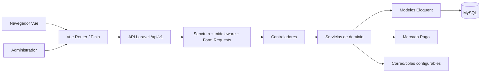
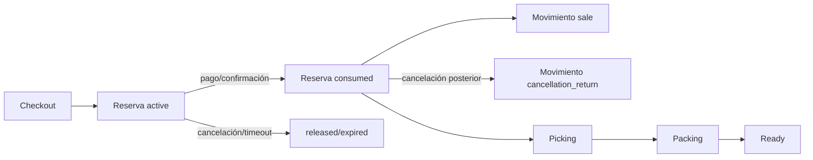
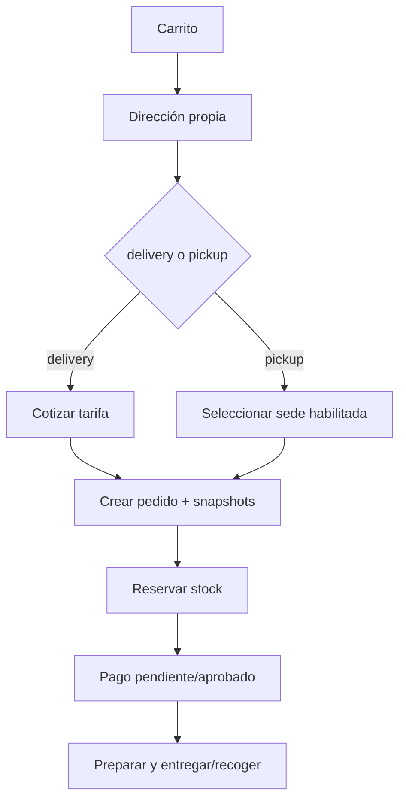
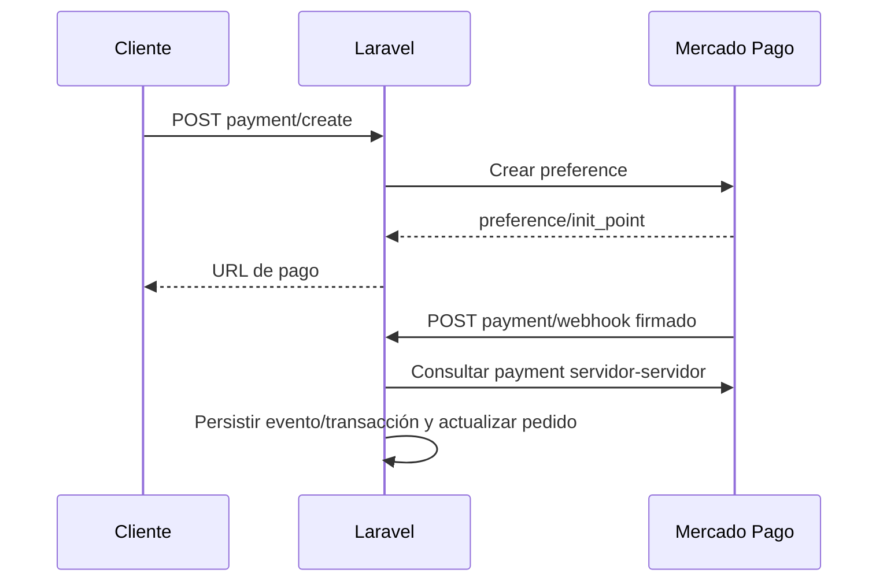
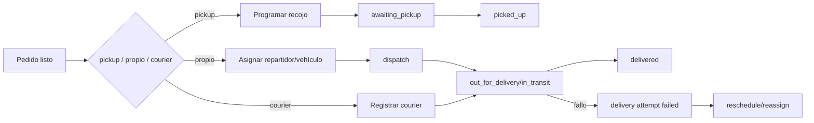
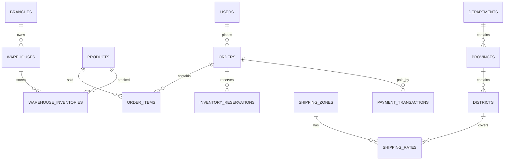

> Consolidación documental de dd2436b. La generación original del 2026-09-04 y sus evidencias locales se conservan como historial; no son verificaciones nuevas de producción. Las secciones de cierre posteriores sustituyen límites históricos incompatibles. El código y las migraciones tienen precedencia. Este lote no ejecutó pruebas, comandos de aplicación ni consultas a bases de datos.

> Actualización posterior del 2026-10-18: A0/A1/A2 quedaron versionados localmente en `d0a73e2` (sección 10C). B3-B añade HTTP privado certificado (10D), todavía sin commit ni despliegue nuevo. Estos cierres sustituyen los pendientes históricos de finalización y HTTP; las afirmaciones anteriores de ausencia de ejecuciones corresponden únicamente a la consolidación documental de dd2436b.

> Auditoría específica de pagos: [AUDITORIA_FLUJO_PAGOS_Y_TESORERIA.md](AUDITORIA_FLUJO_PAGOS_Y_TESORERIA.md). 2B1/2B2/2B3 y 2B4-B1/B2 están implementados y certificados en su alcance. B3-A0/A1/A2 aportan el backend interno y B3-B su HTTP privado certificado localmente. Siguen pendientes frontend Treasury de devolución, integración automática de gateways y aceptación operativa productiva.

# 1. Resumen ejecutivo

## Navegación administrativa

`AdminLayout.vue` mantiene todas las rutas y permisos existentes y ahora ofrece un sidebar desktop expandido (18rem) o contraído (5rem), con preferencia persistida en `localStorage` bajo `lubristore.admin.sidebar.collapsed`. En viewport menor a 1024px funciona como drawer superpuesto de 18rem con overlay, botón hamburguesa, cierre por Escape, clic externo y navegación. La detección usa `matchMedia`, limpia listeners al desmontar y restaura el overflow del documento. Los iconos conservan nombres accesibles, las opciones contraídas muestran tooltip CSS en hover/focus y la ruta activa contempla rutas anidadas. El cambio es exclusivamente frontend; no altera backend, rutas ni permisos.

## Reportes gerenciales (interfaz administrativa)

La ruta protegida `/admin/reports/management` presenta seis pestañas: Ventas, Inventario, Movimientos, Operaciones, Tiempos de ciclo y Catálogos. Cada cambio de pestaña solicita únicamente el contrato JSON de la sección activa; no se cargan reportes ocultos. Los filtros admitidos se conservan en la query string y la exportación utiliza exactamente esos mismos parámetros mediante el endpoint `/api/v1/admin/reports/management/{section}/export`.

Movimientos admite periodo, fechas personalizadas, almacén, producto, categoría, marca, tipo y dirección. Operaciones admite modalidad, severidad, razón, etapa y vencido. Ciclos admite periodo, fechas, modalidad y las siete métricas certificadas. Catálogos admite las doce opciones (`products`, `categories`, `brands`, `warehouses`, `branches`, `drivers`, `vehicles`, `departments`, `provinces`, `districts`, `shipping_zones`, `shipping_rates`) y sus filtros específicos. No existen endpoints ligeros de opciones para departamentos, provincias, distritos o zonas; la interfaz no descarga esos catálogos masivos y deja esos selectores sin opciones hasta que se publique un contrato paginado.

El Dashboard es una vista gerencial agregada distinta de Reportes: el primero conserva su respuesta completa y pestañas visuales locales; Reportes consulta bajo demanda una sección y muestra sus filas, totales, metadatos y truncamiento. Los CSV son UTF-8 con BOM, cabeceras explícitas y neutralización contra inyección de fórmulas. Las respuestas no exponen datos personales. El corte histórico de reportes registró 390 pruebas exitosas, sin nueva ejecución en esta consolidación; la interacción visual con navegador (smoke manual) sigue pendiente.

LubriStore es un comercio electrónico de lubricantes. Resuelve la venta de productos con catálogo, carrito, checkout, reservas de inventario, pago, preparación, despacho, entrega y recojo en sede. Los actores son clientes, administradores y Tesorería; existen entidades operativas para repartidores y vehículos.

El backend es Laravel 9.52.21 sobre PHP 8.3 y MySQL; el frontend es Vue 3 con Vite, Vue Router, Pinia, Axios y PrimeVue. Sanctum protege las sesiones API. Mercado Pago está integrado junto con un gateway mock para pruebas.

**Estado:** catálogo, carrito, territorios, sedes, inventario, reservas, fulfillment, pickup/delivery, consultas y pagos tienen implementación y pruebas existentes. Tesorería incluye B1/B2 certificados y B3-A0/A1 internos. dd2436b está desplegado y levantado en Hostinger con dependencias Composer de producción, `APP_ENV=production`, `APP_DEBUG=false`, todas las migraciones aplicadas —incluida 070630— y administrador seguro creado manualmente. Son hechos de despliegue confirmados, sin acceso al servidor en este lote. Cron/scheduler, workers, correo, monitoreo y aceptación operativa integral no quedan certificados por esa instalación.

Funciones que requieren configuración: credenciales de Mercado Pago, destinatarios de correo, zonas/tarifas comerciales, sedes y almacenes productivos, repartidores/vehículos, colas y scheduler. La zona Carabayllo S/ 8.00 descrita más adelante es exclusivamente local de desarrollo.

# 2. Arquitectura real

| Capa | Implementación confirmada |
|---|---|
| Backend | Laravel 9.52.21, PHP `^8.0.2` |
| Frontend | Vue `^3.5`, Vite `^4`, Vue Router, Pinia |
| HTTP | Axios |
| UI | PrimeVue/PrimeIcons, Tailwind CSS |
| Auth | Laravel Sanctum, `auth:sanctum` |
| DB | MySQL configurado; pruebas usan SQLite en memoria cuando el test lo solicita |
| Pago | `mercadopago/dx-php ^3.16`, gateway mock |
| Colas | Laravel queue configurable por `QUEUE_CONNECTION`; jobs table migrada |
| Scheduler | tarea `inventory:expire-reservations` definida cada minuto y sin solapamiento; ejecución del cron en Hostinger no certificada |
| Mail | Mailables/notificaciones de consultas y pedidos dependen de configuración; no se presume entrega si el mailer no está configurado |
| Archivos | Disco Laravel configurable (`FILESYSTEM_DISK`); evidencias de entrega se almacenan según servicio |

No hay frontend Vitest/Vue Test Utils localizado. La prueba frontend existente es principalmente estática sobre el código Vue.

## Mapa de comunicaciones

| Origen | Destino | Mecanismo | Auth | Datos principales | Fallos controlados |
|---|---|---|---|---|---|
| Navegador | Vue | Router/componentes | Sesión local | formularios, estado Pinia | loading/toast |
| Vue | API | Axios JSON | Bearer Sanctum cuando corresponde | productos, carrito, checkout | 401/403/422/5xx |
| API | Controladores | Routing Laravel | middleware | Request validado | ValidationException |
| Controladores | Servicios | inyección PHP | usuario autenticado | DTO/arreglos | transacciones |
| Servicios | Eloquent/MySQL | ORM/queries | conexión DB | modelos y snapshots | rollback/bloqueos |
| Laravel | Mercado Pago | SDK/Guzzle HTTPS | access token | preference/payment | failed/orphaned |
| Mercado Pago | Laravel | webhook HTTPS | firma HMAC | evento/payment id | ignored/failed |
| Laravel | correo/cola | Mail/Queue | configuración | avisos operativos | reintento/log |

# 3. Seguridad, usuarios y permisos

`AuthController` registra clientes con `role=customer`; los roles disponibles son `admin`, `customer` y `treasury`. `auth:sanctum` autentica endpoints privados, `active_user` rechaza cuentas inactivas, `is_admin` protege administración e `is_treasury` protege la bandeja financiera. No existe un sistema Spatie Permission localizado.

| Actor | Acceso real |
|---|---|
| Cliente | catálogo, carrito, direcciones propias, creación/consulta propia de pedidos, tracking y contacto |
| Administrador | todas las rutas `/api/v1/admin/*`: catálogo, inventario, territorios, sedes, tarifas, pedidos, fulfillment, delivery, pagos configurables y consultas |
| Tesorería | `/api/v1/treasury/*`: bandeja, historial, observación, rechazo, aprobación, apertura de resolución y reasignación/aprobación; acceso directo “Panel de tesorería” para Treasury |
| Repartidor | existe entidad/atributos de repartidor; no se localizó un portal frontend separado. Las operaciones de entrega son administrativas |

Controles confirmados: validación Laravel, propiedad del pedido en endpoints de cliente, `throttle:api`, rate limit de contacto, límites de importación territorial, errores JSON y ocultamiento de secretos/campos internos en Resources o `$hidden`. CSRF aplica al flujo web tradicional; la API usa Sanctum y tokens.

Riesgos: `APP_DEBUG` debe ser falso fuera de local; nunca exponer secretos, contraseñas ni payloads de pago. Administración y Tesorería tienen accesos diferenciados por rol; no existe una matriz general de permisos finos para cada acción.

# 4. Catálogo, productos y carrito

Modelos principales: `Category`, `Brand`, `Product`, `ProductImage`, `OrderItem`. La administración está en `resources/js/views/admin/Products.vue`, `Categories.vue`, `Brands.vue`; catálogo público en `Catalog.vue`, `ProductDetail.vue` y `ProductCard.vue`.

Productos tienen nombre, SKU estable/único, marca, categoría, presentación, precio, precio anterior/descuento según campos existentes, descripción, especificaciones, imágenes y `is_active`. El stock operativo se mantiene en `warehouse_inventories`; `products.stock` es un valor sincronizado temporal por `InventoryService` y no debe editarse desde Productos.

El carrito vive en `resources/js/stores/cart.js`; cantidades se normalizan con `resources/js/utils/cartQuantity.js` (enteros positivos, límites y tratamiento de valores inválidos). El frontend calcula una vista de subtotal, pero el backend recalcula precios, descuentos, envío y total. Stock cero o insuficiente se rechaza en API.

# 5. Inventario, reservas y fulfillment

Entidades: `Branch`, `Warehouse`, `WarehouseInventory`, `InventoryMovement`, `InventoryReservation`, `OrderHandlingProcess`, `OrderHandlingItem`, `OrderHandlingIncident`, `OrderHandlingHistory`, `OrderFulfillmentHistory`.

`InventoryService` es la fuente de movimientos y saldos. Usa transacciones, `lockForUpdate()` e idempotency keys/índices únicos para movimiento inicial, venta por order item, devoluciones y correcciones. Los movimientos son inmutables.

| Evento | Efecto |
|---|---|
| Checkout aceptado | reserva unidades del almacén vendible y registra expiración |
| Pago aprobado/fulfillment | consume reserva y registra movimiento `sale` |
| Cancelación/rechazo/expiración | libera reserva; la devolución registra `cancellation_return` cuando corresponde |
| Ajuste/corrección/traslado | solo desde Inventario y dentro de transacción |
| Picking/packing | valida cantidades y registra trazabilidad; no debe duplicar consumo |

Estados de reserva: `active`, `consumed`, `released`, `expired`. Fulfillment de `Order`: `reserved`, `preparing`, `ready`, `delivered`, `canceled`. Picking/packing usan procesos `pending`, `in_progress`, `completed` e incidentes `open`, `resolved`, `canceled`.

Las reservas están versionadas por `(order_item_id, reservation_sequence)`. `OrderItem::reservations()` conserva el historial; `currentReservation()` selecciona la mayor secuencia y usa `id` como desempate. `reservation()` es su alias de compatibilidad. B2 crea y consume una versión nueva vinculada al caso, sin reactivar la histórica. Tracking y Resources leen la reserva actual y no deducen su vigencia únicamente de `orders.reserved_until`.

La liberación de una reserva activa solo decrementa `reserved_quantity` y actualiza `InventoryReservation` (`released`/`expired`); no crea `InventoryMovement`. El consumo cambia el saldo físico, marca la reserva `consumed` y crea un movimiento `sale`. La cancelación antes del consumo libera la reserva. La cancelación después del consumo llama `returnCancellation()` por `OrderItem`, crea un movimiento `cancellation_return` idempotente y repone inventario. La expiración libera reservas y actualiza estados, sin `cancellation_return`.

# 6. Checkout, pedidos y entrega

Rutas Vue: `Cart.vue`, `Checkout.vue`, `OrderSuccess.vue`, `PaymentReturn.vue`, `Orders.vue`, `OrderTracking.vue`. API principal: `POST /api/v1/orders`, `GET /api/v1/orders`, `GET /api/v1/orders/{order}`, `GET /api/v1/orders/{id}/tracking`, `POST /api/v1/checkout/shipping-quote`, `GET /api/v1/checkout/pickup-branches`.

El pedido se crea con dirección/modalidad, items y `checkout_token`. El servidor valida stock, propiedad de dirección, tarifa y pickup, toma snapshots de dirección/territorio/sede, recalcula importes y reserva inventario. El token es idempotente por usuario.

Modalidades: `delivery` y `pickup`. Delivery exige cobertura y tarifa; pickup exige sede activa, pública y `allows_pickup=true`, con flete cero. La sede seleccionada se snapshot-ea para no alterar pedidos históricos.

Estados comerciales: `pending`, `confirmed`, `shipped`, `delivered`, `canceled`, `rejected`. Tracking delivery: `pending → confirmed → processing → shipped → delivered`; pickup: `pending → confirmed → ready_for_pickup → picked_up`. Son estados separados de `payment_status`, `fulfillment_status` y `OrderDelivery.status`.

# 7. Territorios

Modelos/tablas: `Department`, `Province`, `District`, `TerritoryImport`. El catálogo oficial INEI 2022 versionado contiene 25 departamentos, 196 provincias y 1.891 distritos con UBIGEO de seis dígitos.

`TerritoryNormalizer` conserva códigos como texto y normaliza tildes/espacios/mayúsculas. `TerritorySelectionService` valida la jerarquía y construye snapshots.

Importación administrativa:

- `POST /api/v1/admin/territories/import/preview` valida CSV, checksum, cabeceras, límites y genera conflictos.
- `POST /api/v1/admin/territories/import/confirm` aplica atómicamente con auditoría `TerritoryImport`.
- `GET /api/v1/admin/territories/import/template`, reportes e historial completan el flujo.

`OfficialTerritorySeeder` usa `database/data/territories/inei_ubigeo_2022_1891.csv`, checksum SHA-256 `3e05506c50da1982c13bb4b48cde1bb40c01c349e0151d84a878865561eeb41a`, precarga catálogos, detecta conflictos, conserva IDs y revierte ante error. Es explícito y no forma parte de `DatabaseSeeder`.

# 8. Sedes, almacenes y pickup

`BranchController` administra `/api/v1/admin/branches`; `Branches.vue` ofrece CRUD, estado y sede principal. Los campos incluyen código, nombre, dirección, referencias, teléfono, correo, horario, instrucciones, ubicación territorial, `is_active`, `serves_public`, `allows_pickup` e `is_main`.

Una sede activa no implica pickup: el endpoint público filtra simultáneamente `is_active`, `allows_pickup` y `serves_public`. `WarehouseController` administra almacenes; el inventario web usa el almacén predeterminado configurado, independiente de la sede principal.

En el entorno local revisado, la sede 1 está en Carabayllo y habilitada para pickup; la sede 2 permanece sin ubicación territorial y sin pickup. Estos datos no representan staging ni producción.

# 9. Zonas y tarifas

`ShippingZone` y `ShippingRate` son administrados por `ShippingZoneController`, `ShippingRateController` y `ShippingZones.vue`. Una tarifa vincula una zona y un distrito; el modelo genera snapshots textuales y claves normalizadas. El índice único de distrito activo impide dos coberturas activas globales.

`ShippingRateService::quote()` exige tarifa y zona activas, valida la jerarquía territorial y devuelve importe/plazo o `has_coverage=false`. Los pedidos guardan zona, tarifa, nombres, UBIGEO y plazo como snapshots.

Configuración local actual: zona `CARABAYLLO`, UBIGEO `150106`, tarifa ficticia S/ 8.00, plazo 1–2 días. No es una tarifa comercial definitiva.

# 10. Pagos y Mercado Pago

Métodos expuestos por `PaymentMethodController`: tarjeta/Mercado Pago, transferencia, contraentrega y pago en sede cuando la configuración lo permite. El gateway mock existe para pruebas locales.

Modelos persistentes:

| Modelo | Propósito |
|---|---|
| `PaymentPreference` | preferencia remota, estados `creating`, `active`, `superseded`, `failed`, `orphaned` |
| `PaymentTransaction` | pago/refund; estados `pending`, `received`, `approved`, `failed`, `canceled`; escritura protegida, con promoción controlada `received → approved` en B2 |
| `PaymentWebhookEvent` | deduplicación y procesamiento `received`, `processing`, `processed`, `ignored`, `failed` |
| `PaymentSetting` | configuración editable administrativa |

`POST /payment/create`, `GET /payment/return` y `GET /payment/verify/{paymentId}` están dentro de `auth:sanctum`; `create` y `verify` comprueban propiedad del pedido. `POST /payment/webhook` es público y no usa sesión Sanctum: valida HMAC mediante `x-signature`, `x-request-id`, `data.id` y tolerancia. `PaymentPreferenceService` crea preferencias fuera de transacciones DB y guarda estados `failed`/`orphaned`. `PaymentProcessingService` y `OrderPaymentService` validan importe, moneda, referencia y estado. El retorno es informativo; `verify` exige propiedad y una `PaymentTransaction` local antes de procesar. El estado interno (`pending`, `approved`, `failed`, `canceled`) no es necesariamente igual al remoto (`approved`, `pending`, `in_process`, `rejected`, `refunded`, `charged_back`, `cancelled`). `refunded`, `charged_back` y `cancelled` requieren intervención manual y no reponen inventario automáticamente.

La idempotencia usa claves únicas, referencia externa opaca y eventos persistentes. Pagos aprobados no se aplican dos veces. `refunded`, `charged_back` y `canceled` requieren intervención/flujo financiero controlado; no deben reponer inventario automáticamente sin una política explícita.

Comandos disponibles: `payments:backfill-legacy-preferences` y `payments:reconcile-preferences`; ambos deben ejecutarse primero en dry-run y `--apply` solo con respaldo. La consulta actual `php artisan migrate:status` del 2026-09-08 registra las migraciones `2026_09_04_070500` a `070530` como ejecutadas en la base local. Ese estado debe comprobarse de nuevo antes de cualquier despliegue.

# 10A. Tesorería y transferencias manuales

La infraestructura de Tesorería está implementada y sus migraciones están aplicadas en Hostinger según el despliegue confirmado. Incluye presentaciones, historial y cuentas receptoras. La configuración de cuentas conserva `auth:sanctum`, `active_user` e `is_admin`; la bandeja financiera tiene `is_treasury`. Las cuentas Yape, Plin y banco se cifran cuando corresponde, usan un default activo único por canal y sirven QR privado. Las certificaciones SQLite/MySQL de los cierres financieros se detallan en la auditoría; no implican certificación nueva de toda la operación productiva.

Fase 2B1-A expone opciones de transferencia y QR privado al propietario autenticado del pedido elegible. Fase 2B1-B registra `PaymentSubmission` con `Idempotency-Key`, importe desde `orders.total`, PEN, fingerprint, historial append-only, locks y extensión sincronizada de reserva; no altera `payment_status`, `paid_at`, inventario ni `PaymentTransaction`. Fase 2B1-C integra el panel cliente en tracking: recupera primero la presentación, sigue a opciones solo ante `404 payment_submission_not_found`, obtiene QR como blob y libera ObjectURL. Tracking expone `reserved_until` ISO o `null`.

El smoke histórico de 2B1 verificó creación y recuperación de la presentación, operación enmascarada y extensión sincronizada de reserva, sin aprobar pago ni consumir inventario; utilizó un QR de prueba. Posteriormente 2B2 incorporó bandeja, observación/rechazo y corrección idempotente, y 2B3 añadió aprobación financiera atómica e interfaces. El botón legacy solo continúa para pedidos sin presentación; con presentación devuelve `treasury_approval_required`.

## 10B. Resolución vigente 2B4-B1/B2

B1 registra el pago recibido cuando no procede la aprobación ordinaria: crea una `PaymentTransaction received`, un caso `open`, la presentación `manual_resolution_required` e historiales coherentes, con reintento idempotente. B2 reasigna y consume nuevas reservas, sincroniza inventario, promueve esa misma transacción `received → approved` mediante `approveReceivedForResolution()`, aprueba la presentación y cierra el caso `stock_reassignment/reassigned`. No crea un segundo pago; solo reabre un pedido cancelado cuando existe evidencia de expiración automática.

Las rutas `POST /api/v1/treasury/payment-submissions/{submission}/resolution` y `POST /api/v1/treasury/payment-submissions/{submission}/resolution/reassign` exigen autenticación, usuario activo y Treasury, body vacío y claves construidas por el servidor. Requests, controller, Resources privados y `TreasuryPayments.vue` están implementados. La UI usa elegibilidad backend, confirmación y refresco de detalle/historial/listado. El cliente ve el estado financiero enmascarado y la reserva actual. B1/B2 tienen certificación existente SQLite/MySQL y smoke manual documentados; este lote no los repite.

## 10C. Reembolsos B3-A0/A1/A2 internos, versionados en d0a73e2

B3-A0 generaliza `PaymentRefund` mediante 070630: pago original nullable con FK `RESTRICT` y UNIQUE independiente, caso opcional y asiento de devolución separado. El backfill exige `payment/approved` y coherencia de pedido, presentación, importe y moneda entre pago, caso y refund, sin un pago aprobado competidor bajo esos criterios. La existencia del identificador recibido por sí sola no basta. El modelo protege la identidad original, cifra la referencia externa y oculta relaciones financieras.

B3-A1 implementa únicamente `TreasuryPaymentRefundService::markPending()`: Treasury activo inicia manualmente un reembolso total de un pedido pagado y cancelado, no entregado ni recogido, con un único pago aprobado por el total en PEN e inventario compensado. Admite todos los medios cobrados, sin fabricar presentación ni caso. Crea refund `pending`, exige pago original al crear, marca pedido y eventual presentación `refund_pending` y añade historial allowlisted. El caso B2 queda intacto; el refund no lo utiliza como ciclo de devolución. La transacción exterior tiene tres intentos y no modifica inventario.

Las tres brechas anteriores están corregidas en dd2436b: snapshots confidenciales canonicalizados con comparación segura; harness físico MySQL que exige SQLSTATE `40001`/driver `1213` y descarta `1205`; regresión aislada de FK homónima incorrecta conservando válida la UNIQUE. La auditoría identifica las suites y el worker. Se conserva la certificación existente y se distingue de la cobertura inspeccionada; esta consolidación no ejecuta pruebas.

El contrato B3 es exclusivamente total, para todos los medios cobrados, con inicio y finalización manual por Treasury —puede ser el mismo usuario—, referencia externa obligatoria al completar y sin gateway automático. Pedidos entregados o recogidos quedan fuera. **B3-A2 está implementado y certificado como servicio interno local**: `complete(int $refundId, int $actorId, string $externalReference)` crea un único asiento `refund/approved` manual por el total, completa el refund y marca pedido y presentación opcional `refunded`, con exactamente un historial `refund_completed` cuando corresponde. El pago original y el caso B2 permanecen intactos; no modifica inventario ni logística. La exposición HTTP posterior se describe en 10D; el frontend sigue pendiente.

La referencia se valida como UTF-8 sin controles ni saltos, con espacios exteriores normalizados y máximo de 255 bytes; solo se persiste cifrada en el refund. Un reintento coherente por cualquier Treasury activo con la misma referencia normalizada no escribe ni cambia `completed_by`; otra referencia o cierre parcial produce conflicto. El retorno conserva la instancia bloqueada/escrita con `unsetRelations()`, sin relectura susceptible al snapshot MySQL anterior. El orden financiero actual empieza por presentación opcional y pedido, seguido por transacciones, casos, refunds, historiales y actor/entrega/handling; luego se valida inventario. Se mantienen tres intentos transaccionales.

El seam protegido vacío `afterCompletionOrderLocked(Order $order)` se ejecuta dentro del callback, tras bloquear y validar el pedido y antes de las consultas financieras amplias. El worker A2 forma allí el ciclo físico entre pedidos, registra y relanza la misma excepción; el segundo intento no repite la barrera. No introduce consultas, estado ni efectos en producción.

La certificación nueva del 2026-10-18 aprobó individualmente los seis datasets MySQL (diez carreras cada uno), la regresión determinista stale y A1 físico; después aprobó la clase MySQL completa: **8 tests, 4071 assertions**. Cada deadlock exige exactamente un retry con `40001/1213`, descarta `1205` y verifica nuevas instancias. SQLite aprobó A2 con **112 tests, 635 assertions** y regresiones A1/B2 e inventario versionado con **339 tests, 3803 assertions**; existe cobertura heredada/solapada. La auditoría detalla los conteos individuales. Pint, `php -l` y diff-check aprobaron. Solo se utilizó MySQL temporal aislado `_test`, ya eliminado, sin acceso comercial ni a Hostinger.

A0/A1/A2 quedaron versionados localmente en `d0a73e2`; el pendiente HTTP de aquel corte queda sustituido por 10D. Siguen pendientes frontend y adaptación de mensajes/filtros a los estados de devolución. No existe acción visible de reembolso ni integración automática con proveedores; cancelar no inicia un refund. Los históricos sin pago original deducible requieren revisión antes de habilitar el flujo completo. No se acredita un despliegue nuevo, devoluciones reales ni operación integral productiva.

## 10D. B3-B: capa HTTP privada de reembolsos certificada localmente

`POST /api/v1/treasury/orders/{orderId}/refunds` delega en `markPending()` respetando su firma con pedido persistido, usuario autenticado y motivo. `POST /api/v1/treasury/payment-refunds/{refundId}/complete` delega en `complete()` con refund ID, actor autenticado y referencia. El controller no abre transacciones, toma locks ni replica elegibilidad o reglas de inventario.

Las dos rutas exigen `auth:sanctum`, `active_user` e `is_treasury`. Usan parámetros escalares para que la autorización preceda a cualquier búsqueda del recurso: 401 anónimo; 403 no Treasury o inactivo; 404 seguro para ID inválido o inexistente tras autorizar. La matriz certifica respuestas iguales con recurso existente/inexistente y ninguna consulta de pedido/refund ni llamada al servicio para no autorizados.

`MarkTreasuryPaymentRefundPendingRequest` y `CompleteTreasuryPaymentRefundRequest` aceptan exclusivamente su campo requerido de tipo string; rechazan estructuras anidadas, arrays, archivos, campos extra y claves idempotentes del cliente. Aplican los límites compatibles con A1 y la referencia A2 UTF-8 de una línea, sin controles y con máximo de 255 bytes después del trim exterior admitido. No duplican decisiones financieras ni alteran la cadena entregada al servicio. `TrimStrings` conserva la entrada únicamente para esos dos POST, de modo que no borra controles antes de validarlos; los demás endpoints mantienen el comportamiento normal.

`TreasuryPaymentRefundResource` usa una allowlist sin consultas: IDs del refund/pedido, estado, importe, moneda, medio de pago original, fechas, mensaje seguro y `can_complete` derivado del estado solo para presentación. No expone textos libres, referencias, claves internas, datos personales ni relaciones financieras. La ejecución inicial y el retry coherente responden 200. Solo `PaymentRefundConflictException` se mapea a 409 con mensaje fijo y `payment_refund_conflict`; `QueryException` y errores inesperados conservan el 500 seguro global con debug desactivado. Validación sigue en 422. Éxitos y conflictos envían `Cache-Control: no-store, private` y `Pragma: no-cache`.

Certificación local del 2026-10-18, anterior al ajuste del matcher: `TreasuryPaymentRefundHttpTest` aprobó en SQLite `:memory:` (**116 tests, 693 assertions**) y MySQL 8.4.3 aislado (**116 tests seleccionados, 682 assertions; 114 ejecutados y 2 skips preexistentes A1 de deadlocks sintéticos bajo RefreshDatabase**). Son 51 casos HTTP y 65 heredados; ningún caso HTTP quedó omitido. El preflight comprobó testing, debug desactivado, driver MySQL, base propia `_test` distinta de la comercial, versión 8.x y 070630 aplicada. También aprobaron las regresiones SQLite A1/A2, infraestructura, Reassignment HTTP/servicio/atomicidad, aprobación y apertura de resolución; infraestructura conserva un skip exclusivo de MySQL ya existente.

La fixture de reposición ausente elimina por ID exactamente una fila sintética mediante Query Builder y verifica su ausencia antes del snapshot, sin alterar la protección del modelo. El cierre de higiene solo ejecutó focalizados de controles (**7 tests/28 assertions**), trim del servicio (**3/182**) y middleware aislado (**5 casos/10 comparaciones**); no repitió suites completas. Pint normalizó únicamente finales de línea de `TrimStrings.php`; los siete PHP B3-B pasan Pint y sintaxis, `git diff --check` y `route:list` de ambas rutas. La instancia y los temporales propios se limpiaron y el directorio señalado se comprobó ausente. No se repitió el harness físico: la concurrencia A0/A1/A2 permanece cubierta por `d0a73e2`.

B3-B queda certificado como HTTP privado local y listo para revisión estática; no se realizó staging, commit o despliegue del lote. Frontend Treasury de reembolsos, integración de gateways, revisión de históricos y aceptación operativa productiva siguen pendientes. No se acredita certificación productiva integral ni se accedió a Hostinger o a la base comercial.

El P2 posterior de alcance de `TrimStrings` se corrigió sustituyendo los comodines por regex ancladas sobre `path()`, con un segmento no vacío y método POST estricto, sin estado ni validación numérica. La regresión aislada verificó 84 combinaciones en ambos órdenes con una misma instancia (**1 test/336 assertions**); los focalizados de payloads y controles aprobaron (**24/96**). La suite SQLite actual aprobó con **117 tests/1029 assertions**, incluyendo el nuevo test aislado. Pint, sintaxis de los dos PHP tocados y diff-check aprobaron. No se repitió MySQL: los 116 tests anteriores conservan su carácter histórico; no cambió persistencia, servicio ni concurrencia.

## 10E. B3-C0: contrato interno de disponibilidad de solo lectura

`TreasuryPaymentRefundAvailabilityService::forOrder(int $orderId)` recarga evidencia sin locks, transacciones, escrituras ni llamadas a A1/A2. Devuelve `TreasuryPaymentRefundAvailability`, una clase `readonly` serializable con solo tres booleanos: `can_mark_refund_pending`, `can_complete_refund` y `requires_manual_review`. Las exclusiones normales de negocio deshabilitan acciones sin implicar corrupción; evidencia relacionada incompleta, cruzada o incompatible exige revisión manual. Completed coherente no ofrece acciones. Los errores SQL e inesperados se propagan.

El trait `TreasuryPaymentRefundPredicates` contiene los predicados puros compartidos con los comandos: identidad/cardinalidad del pago, pedido, importe, moneda, método, paid_at, cancelación sin entrega/recojo, presentación y B2 opcionales, compensación y reservas históricas, reservas activas globales/saldos, movimientos, stock, refund e historial. La disponibilidad pending excluye la referencia concreta aún no introducida. No agrega atributos persistibles a Eloquent ni realiza lazy loading al serializar el resultado. A1/A2 conservan el orden de adquisición, las 16 llamadas originales de bloqueo, el seam y las cuatro llamadas transaccionales con máximo de tres intentos; A2 sigue retornando la instancia bloqueada/escrita. Los POST siempre revalidan.

El Resource de historial omite `reason` y campos derivados de metadata en ambos eventos de reembolso, también al incluirse en el detalle de presentación. No sustituye el contenido por hashes ni máscaras, no altera lo persistido y conserva motivos autorizados de los demás eventos.

La certificación C0 local aprobó en SQLite `:memory:`: disponibilidad **100 tests/867 assertions** (65 heredados A1), A1 **65/241**, A2 **121/681**, HTTP B3-B **117/1029**, Reassignment servicio **131/1290** y revisión Treasury **18/229**. Son ejecuciones con cobertura solapada. En MySQL 8.4.3 temporal aislado aprobaron C0 **100 tests seleccionados/856 assertions** (98 ejecutados y dos skips A1 preexistentes; ningún caso C0 omitido) y los focalizados de historial **2/41**. El preflight confirmó testing, debug desactivado, driver MySQL, base propia `_test` distinta de la comercial y migración 070630 aplicada.

Se verificaron repetibilidad, snapshots públicos/confidenciales canonicalizados, ausencia de escrituras/eventos/transacciones/locks de lectura, conexión utilizable y concordancia con comandos reales. Pint, sintaxis PHP y diff-check aprobaron. La instancia y los temporales propios se retiraron. No se repitieron harnesses físicos porque la adquisición de locks y la lógica transaccional permanecen iguales.

C0 es un contrato interno local todavía sin commit o despliegue; no añade GET, listado paginado, Vue, router, navegación, modales, gateways o migraciones. Lectura HTTP y frontend B3-C, revisión de históricos y aceptación operativa productiva continúan pendientes. No acredita certificación productiva integral.

## 10F. B3-C1: lectura HTTP privada de reembolsos

Este cierre posterior reemplaza el pendiente de GET de la sección C0; su contrato interno ya está versionado en `836c16b`. C1 añade `GET /api/v1/treasury/refund-worklist` y `GET /api/v1/treasury/orders/{orderId}/refund-state`, con `auth:sanctum`, `active_user`, `is_treasury` y autorización anterior al lookup escalar. Request estricto, controller delegado y Resource específico de lectura; sin nuevos POST, Vue, gateways o migraciones. Éxitos y respuestas controladas 404/422 tienen headers privados/no-store. QueryException se propaga como 500 seguro, sin convertirse en revisión manual o 409.

Order es la raíz de la selección SQL. Incluye todos los medios aprobados con/sin presentación, proyecciones de refund, asientos, historiales y devoluciones vinculadas por original, contabilidad o caso/presentación/pago recibido. Un histórico nullable deducible se muestra en revisión; un vínculo contradictorio no atribuye la devolución a un pedido, y un histórico sin ningún pedido deducible queda fuera de este read-model y requiere auditoría interna separada.

La evidencia se agrupa en `TreasuryPaymentRefundReadEvidence` y la disponibilidad se evalúa mediante `forOrders()` y los predicados compartidos. La equivalencia con `forOrder()` está probada. Campos y booleanos de la fila proceden del mismo lote; el resultado solo contiene campos públicos allowlisted, importes decimal string o null, resumen mínimo del refund y mensajes fijos. No hay lazy loading en Resource, modelos completos, datos del cliente o textos/identificadores financieros privados. Los POST siempre revalidan; no existe snapshot transaccional entre solicitudes de lectura.

Filtros: `order` por ID/número `#`, `payment_method` de Order, `refund_status` (`not_started`, `pending`, `completed`, `manual_review`), fechas inclusivas de **orders.created_at**, `page`, `per_page`. `relevant_at` es esa misma fecha pública. Máximo y predeterminado: 20; orden por creación y desempate ID. La revisión manual tiene prioridad sobre el estado nominal del refund. El usuario autorizó el recorrido exacto de candidatos en lotes de 20 para el filtro de estado: se retienen IDs y se aplican a la paginación SQL, conservando total exacto sin post-filtrar páginas. Su costo depende de candidatos totales y la memoria de IDs de coincidencias; no es costo constante por página. Evidencia: 19 consultas por lote, 21 por página ordinaria; presupuestos comprobados de 24 para 1/20/máximo y 48 para un lote de filtro completo más página. Listado Laravel `data/links/meta`; estado puntual `data` idéntica a una fila, disponible aun fuera de filtros.

SQLite aprobó servicio **74/484**, HTTP C1 **92/457**, Availability **144/1446**, A1 **65/241**, A2 **121/681**, HTTP B3-B **117/1029** e historial **42/328**. MySQL 8.4.3 aislado aprobó servicio **74 seleccionados/72 ejecutados/2 skips heredados/473 assertions**, HTTP C1 **92/90/2/446**, paginación de servicio **1/6** y filtros/paginación HTTP **17/113**. Ningún caso nuevo C1 fue omitido; los dos skips por suite y los 65 casos A1 heredados son cobertura solapada. El preflight verificó testing/debug false/mysql/base propia `_test` y 070630 aplicada. Calidad y route-list aprobaron; recursos temporales retirados. No cambió A1/A2 ni se repitieron harnesses físicos.

C1 está certificado solo localmente, pendiente de revisión estática y sin commit/despliegue. Frontend Treasury, gateways y operación productiva siguen pendientes. Este read-model no acredita certificación productiva integral.

### Corrección posterior de límites y coherencia C1

Sustituye el recorrido inicial de C1: cada intento fija la frontera `max(order.id)`, avanza estrictamente por ID en lotes de 20 y compara dos adquisiciones mediante HMAC efímero privado de evidencia y resultado. Si cambian, reinicia desde una nueva frontera, con tres intentos totales/dos reinicios. La página se materializa en SQL desde una relación derivada acotada de filas públicas de la observación validada; no vuelve a consultar el dominio ni combina clasificación antigua con estados nuevos. `meta.total`, IDs y estado solicitado pertenecen a esa observación, sin post-filtrar páginas. Es validación optimista read-only, sin snapshot transaccional, locks o cambios de aislamiento.

Límites exactos: 200 candidatos evaluados, 100 coincidencias/materializaciones, lote y consultas por IDs de adquisición de 20, 1000 filas por familia de evidencia, 200 reservas activas globales, 64 consultas por adquisición batch, tres intentos. Se admite una fila/ID adicional únicamente para detectar exceso antes de evaluar/devolver información parcial. El filtro de estado ya no construye un IN creciente. La relación SQL de paginación contiene como máximo 100 filas públicas constantes y la página sigue limitada a 20. El costo por relaciones y reinicios no es constante por página; los universos grandes deben reducirse mediante filtros.

`PaymentRefundReadConflictException` es una excepción de dominio sin HTTP ni evidencia privada. El controller la traduce a 409 genérico, código `payment_refund_read_conflict`, headers privados/no-store y ausencia de datos/totales parciales. SQL y errores inesperados siguen como 500 seguro. La adquisición de ítems globales utiliza solo ítems propios y referencias de reservas activas, fragmentadas y deterministas. La prueba de 250 históricos ajenos acredita dos ítems realmente hidratados y conserva la reserva legítima de otro almacén, así como la detección de cruces. Los presupuestos comprobados de 24 consultas por página básica 1/20/máximo y 48 por filtro exacto básico se conservan; el techo general de adquisición es 64. El dato anterior de 19 consultas fijas queda como evidencia histórica del diseño sustituido.

Certificación final: SQLite servicio C1 83/517, HTTP C1 95/470, Availability 144/1446, A1 65/241, A2 121/681, HTTP B3-B 117/1029 e historial 42/328. MySQL 8.4.3 aislado: servicio 83 seleccionados/81 ejecutados/2 skips heredados/506 assertions, HTTP 95/93/2/459, focalizados de servicio 10/39 y HTTP 3/13. Ningún caso nuevo fue omitido. Se verificaron cambios entre clasificación/materialización, reinicio y agotamiento, inserciones fuera de frontera, cursor, varios lotes, páginas fuera de rango y límites sin totales parciales. Preflight estricto, Pint, sintaxis, route-list y diff-check aprobados; recursos propios retirados. A1/A2, Predicates y esquema no cambian. Pendiente revisión estática focalizada posterior; no listo para staging, sin commit/push/despliegue. Frontend, gateways y certificación productiva continúan pendientes.

# 11. Preparación, despacho y entrega

`OrderPickingPackingController`/`OrderPickingPackingService` gestionan picking y packing manual con snapshots, cantidades, incidentes e historial. `OrderFulfillmentService` centraliza estados de preparación. `OrderDeliveryService` gestiona métodos `store_pickup`, `own_delivery`, `external_courier`, programación, asignación, despacho, intentos, fallos, reprogramación y confirmación.

`DeliveryDriver` y `DeliveryVehicle` tienen CRUD administrativo, códigos, disponibilidad, documentos y vencimientos. Tipos de vehículo y licencia se definen en el modelo; bicicletas están exentas según `LICENSE_EXEMPT_TYPES`. Se soportan campos nuevos `driver_id/vehicle_id` y compatibilidad legacy `delivery_user_id/vehicle_plate` mediante snapshots.

No se permite compartir una asignación activa de repartidor/vehículo. Los intentos e historiales son append-only y los snapshots preservan datos históricos.

# 12. Consultas y notificaciones

`ContactInquiry` soporta `pending`, `in_attention`, `attended`, `closed`, `spam`; `ContactInquiryService`, notas, historiales, asignación y acciones email/WhatsApp están implementados. Hay contador de pendientes en dashboard. El correo depende de `CONTACT_NOTIFICATION_EMAIL`, `MAIL_*` y `QUEUE_CONNECTION`; no se deben escribir destinatarios en código.

La existencia de configuración de cola no garantiza que un worker esté ejecutándose. Deben verificarse workers, reintentos, `failed_jobs`, SMTP y logs por entorno.

# 13. Panel administrativo

| Sección | Frontend | Endpoint principal | Finalidad |
|---|---|---|---|
| Dashboard | `/admin/dashboard` | `/admin/dashboard` | métricas |
| Productos | `/admin/products` | `/admin/products` | catálogo/precios |
| Categorías/Marcas | `/admin/categories`, `/admin/brands` | mismos prefijos | clasificación |
| Inventario | `/admin/inventory` | `/admin/inventories`, movimientos | stock y operaciones |
| Sedes/Almacenes | `/admin/branches`, `/admin/warehouses` | CRUD respectivos | red logística |
| Territorios | `/admin/territories` | location + import | catálogo INEI |
| Envío | `/admin/shipping` | zones/rates | cobertura/tarifas |
| Pedidos | `/admin/orders` | `/admin/orders` | operación comercial |
| Picking/Packing | panel de pedido | fulfillment/picking/packing | preparación |
| Delivery | panel de pedido | `/admin/orders/{order}/delivery/*` | despacho/entrega |
| Repartidores/Vehículos | `/admin/delivery-drivers`, `/admin/delivery-vehicles` | CRUD | flota |
| Pagos | `/admin/payment-settings` | payment-settings | configuración |
| Consultas | `/admin/contact-inquiries` | contact-inquiries | atención |
| Contenido | sliders/news | respectivos CRUD | portada/contenido |

Todas las rutas administrativas requieren `auth:sanctum` + `is_admin`.

# 14. API principal

La lista completa se obtiene con `php artisan route:list`. Rutas públicas: productos, categorías, marcas, noticias, sliders, contacto, departamentos/provincias/distritos, cotización, pickup y métodos de pago. Rutas autenticadas: auth/user, addresses, orders, tracking, payment create/return/verify/webhook. Rutas administrativas: todos los prefijos descritos en la tabla anterior.

Contratos críticos:

| Método/ruta | Obligatorios | Efectos |
|---|---|---|
| `POST /orders` | `checkout_token`, items, `delivery_type`, datos de entrega/pickup, método | recalcula, snapshot, reserva, crea pedido idempotente |
| `POST /checkout/shipping-quote` | dirección/territorio | cotiza sin crear pedido |
| `GET /checkout/pickup-branches` | ninguno | sedes activas habilitadas |
| `POST /payment/create` | pedido/preferencia válida | crea preference remota/persistente |
| `POST /payment/webhook` | payload + firma | registra evento, verifica MP y actualiza pago |
| `GET /payment/verify/{paymentId}` | payment id | consulta/compatibilidad visual, no sustituye webhook |
| `POST /admin/territories/import/preview` | CSV | preview/conflictos, sin escritura comercial |
| `POST /admin/territories/import/confirm` | import válido | aplicación atómica/auditable |

# 15. Base de datos y relaciones

| Tabla | Modelo | Propósito | Histórico/eliminación |
|---|---|---|---|
| users | `User` | cuentas/roles | pedidos e historiales preservan referencias |
| products/product_images | `Product`/`ProductImage` | catálogo | stock operativo separado |
| branches/warehouses | `Branch`/`Warehouse` | sedes y almacenes | no eliminar con dependencias |
| warehouse_inventories | `WarehouseInventory` | físico/reservado | movimientos transaccionales |
| inventory_movements | `InventoryMovement` | auditoría stock | inmutable |
| inventory_reservations | `InventoryReservation` | reserva | estados explícitos |
| orders/order_items | `Order`/`OrderItem` | venta | snapshots y FKs protegidas |
| shipping_zones/shipping_rates | `ShippingZone`/`ShippingRate` | cobertura | tarifas usadas por pedidos no se borran |
| departments/provinces/districts | territorios | INEI/UBIGEO | FKs restrictivas |
| payment_* | modelos de pago | preferencia/evento/transacción | transacciones protegidas; promoción B2 controlada |
| order_delivery* | delivery/historial | despacho | historial append-only |
| contact_inquiries* | consultas | atención | archivar/conservar, no borrado común |

# 16. Variables de entorno y zona horaria

Variables relevantes (valores reales nunca se documentan): `APP_ENV`, `APP_DEBUG`, `APP_URL`, `APP_TIMEZONE`, `DB_*`, `SANCTUM_STATEFUL_DOMAINS`, `SESSION_*`, `QUEUE_CONNECTION`, `MAIL_*`, `FILESYSTEM_DISK`, `MERCADOPAGO_PUBLIC_KEY`, `MERCADOPAGO_ACCESS_TOKEN`, `MERCADOPAGO_WEBHOOK_SECRET`, `MERCADOPAGO_SANDBOX`, `MERCADOPAGO_WEBHOOK_TOLERANCE_SECONDS`, `PAYMENT_GATEWAY`, `PAYMENT_MOCK_ENABLED`, `PAYMENT_TESTING_LEGACY_WEBHOOK`, `CONTACT_NOTIFICATION_EMAIL`, `TERRITORY_IMPORT_*`, `INVENTORY_RESERVATION_MINUTES`.

La configuración revisada usa `America/Lima`. `now()`, expiración de reservas, vencimientos de documentos y tolerancia de webhook usan instantes del backend. La interfaz puede formatear fechas en la zona del navegador; para fechas comerciales debe preferirse el valor del servidor y distinguir fecha calendario de timestamp.

# 17. Diccionario de estados y reglas críticas

| Entidad | Estados |
|---|---|
| Order | pending, confirmed, shipped, delivered, canceled, rejected |
| Payment | pending, approved, rejected, refund_pending, refunded; `in_process` se normaliza a pending |
| PaymentPreference | creating, active, superseded, failed, orphaned |
| PaymentTransaction | pending, received, approved, failed, canceled; promoción received → approved controlada en B2 |
| WebhookEvent | received, processing, processed, ignored, failed |
| Reservation | active, consumed, released, expired |
| Delivery | pending, scheduled, assigned, dispatched, out_for_delivery, in_transit, awaiting_pickup, delivered, failed_attempt, rescheduled, canceled |
| Import | preview/processing/completed/failed según servicio |

Reglas estables: no doble consumo de inventario; no doble aprobación financiera; retorno del navegador no confirma pago; webhook firmado es autoritativo; pickup no requiere repartidor; delivery propio requiere asignación; pedidos conservan snapshots; distrito sin tarifa activa no tiene cobertura; importación territorial es atómica; cantidad de carrito es entero positivo y no supera límites/stock.

## Catálogo de reglas trazables

| Código | Regla | Implementación | Prueba |
|---|---|---|---|
| BR-INV-001 | saldo y movimiento son atómicos | `InventoryService` | `InventoryPhaseTwoTest` |
| BR-INV-002 | reserva no se consume dos veces | `InventoryReservation*` | `InventoryReservationPhaseThreeTest` |
| BR-PAY-001 | webhook verifica firma/importe | `PaymentWebhookSignatureService`, `PaymentProcessingService` | `PaymentWebhookAdversarialTest` |
| BR-PAY-002 | transacción protegida; promoción received → approved solo por operación B2 controlada | `PaymentTransaction` | `PaymentPersistenceModelTest`, suites de reasignación |
| BR-ORD-001 | token idempotente por usuario | `OrderController`/migración | `CheckoutPickupBranchTest` |
| BR-SHP-001 | una tarifa activa por distrito | `ShippingRateController` + índice | `ShippingRatesCheckoutTest` |
| BR-TER-001 | jerarquía oficial y códigos estables | `TerritorySelectionService` | `TerritoryCatalogTest` |
| BR-PUP-001 | pickup exige sede elegible y flete cero | `OrderController` | `CheckoutPickupBranchTest` |
| BR-DEL-001 | entrega conserva intentos/historial | `OrderDeliveryService` | `OrderDeliveryPhaseFiveTest` |
| BR-CART-001 | cantidades normalizadas | `cartQuantity.js` | `CartQuantityFrontendTest` |

# 18. Inventario de pruebas

Motor: PHPUnit 9.6.31/Laravel TestCase; varias pruebas usan SQLite en memoria y `RefreshDatabase`. La certificación de Mercado Pago se realizó además en una base aislada MySQL 8; SQLite no demuestra por sí sola toda la concurrencia/locking de MySQL.

Suites localizadas: `AdminCatalogManagementTest`, `ProductCreationInventoryTest`, `BranchWarehouseManagementTest`, `InventoryPhaseTwoTest`, `InventoryReservationPhaseThreeTest`, `ReservationExpirationTest`, `OfficialTerritorySeederTest`, `TerritoryImportTest`, `TerritoryCatalogTest`, `ShippingRatesCheckoutTest`, `CheckoutPickupBranchTest`, `OrderFulfillmentPhaseThreeBTest`, `OrderPickingPackingPhaseFourTest`, `OrderDeliveryPhaseFiveTest`, `DeliveryFleetManagementTest`, `PaymentConfigurationAndSimulationTest`, `PaymentPersistenceModelTest`, `PaymentWebhookAdversarialTest`, `ContactInquiryModuleTest`, `CartQuantityFrontendTest`, `CheckoutPickupFrontendStateTest` y auxiliares en `tests/Concerns`.

Resultado histórico reciente del repositorio: **263 tests, 1.750 assertions, OK, exit code 0**. No se volvió a ejecutar la suite completa durante esta revisión documental porque no se modificó código productivo. No hay suite frontend interactiva localizada. Deben añadirse pruebas manuales de navegador, concurrencia MySQL real, correo, workers y Mercado Pago sandbox.

# 19. Operación y mantenimiento

Diagnóstico seguro: `php artisan about`, `php artisan route:list`, `php artisan migrate:status`, `php artisan test`, `npm run build`, `vendor/bin/pint --test`, `composer validate`, `git diff --check`, `git status --short`.

Mutantes: `php artisan migrate`, `db:seed`, backfill, `reconcile --apply`, limpieza territorial, cache/queue operations. Requieren respaldo, ambiente confirmado, base seleccionada, logs y plan de rollback. Nunca ejecutar migraciones o seeders en producción sin ventana y evidencia.

# 20. Despliegue y checklist

**Local:** `.env` local, mock de pago, catálogo oficial, sedes/almacenes de prueba, workers opcionales.

**Staging:** respaldo, rama/commit aprobado, `APP_ENV=staging`, `APP_DEBUG=false`, HTTPS, variables MP sandbox, webhook público, mail/queue/scheduler, aplicar únicamente migraciones aprobadas para ese entorno y smoke tests.

**Producción:** respaldo probado y restaurable, credenciales reales en secreto gestionado, `APP_DEBUG=false`, dominio HTTPS, webhook firmado, workers supervisados, scheduler, observabilidad, límites, pruebas de rollback y aprobación comercial de tarifas.

**Despliegue confirmado de dd2436b:** Hostinger ya está operativo, Composer se instaló con dependencias de producción, el entorno es `production` con debug desactivado, todas las migraciones están aplicadas —incluidas 070570–070630— y el administrador seguro se creó manualmente. No se documentan datos de acceso. Este estado no certifica cron/scheduler, workers/colas, correo, monitoreo, recuperación ni comportamiento productivo de reembolsos. Los requisitos anteriores permanecen como criterios de aceptación, no como pendientes de clonar o instalar nuevamente.

# 21. Estado funcional

> **Matriz histórica del corte local original.** Las columnas Staging/Producción y pendientes de despliegue no son una evaluación actual de Hostinger. Para el estado vigente prevalecen las secciones 10A–10C y 20; los “No” históricos no niegan el despliegue confirmado ni certifican su operación integral.

| Módulo | Implementado | Probado | Configuración | Local | Staging | Producción | Observación |
|---|---|---|---|---|---|---|---|
| Auth/Sanctum | Sí | Sí | Sí | Sí | Parcial | No | faltan secretos/HTTPS |
| Catálogo/carrito | Sí | Sí | No | Sí | Parcial | Parcial | falta smoke visual |
| Territorios INEI | Sí | Sí | No | Sí | Parcial | Parcial | importar en cada entorno |
| Sedes/almacenes | Sí | Sí | Sí | Sí | Parcial | No | ubicación/tarifas comerciales |
| Pickup | Sí | Sí | Sí | Sí | Parcial | No | sede y horarios reales |
| Zonas/tarifas | Sí | Sí | Sí | Sí | Parcial | No | Carabayllo es ficticio local |
| Checkout/reservas | Sí | Sí | Sí | Sí | Parcial | No | pruebas MySQL/concurrencia |
| Pagos mock | Sí | Sí | No | Sí | No aplica | No aplica | testing |
| Mercado Pago | Parcial | Sí aislado | Sí | Parcial | Parcial | No | migraciones/configuración |
| Picking/packing | Sí | Sí | Sí | Sí | Parcial | Parcial | operación manual |
| Delivery/flota | Sí | Sí | Sí | Sí | Parcial | Parcial | datos/documentos reales |
| Consultas/correos | Sí | Sí | Sí | Parcial | Parcial | No | worker/SMTP |
| Auditoría/reportes | Parcial | Parcial | Sí | Sí | Parcial | No | validar requisitos comerciales |

# 22. Guía para el administrador

Orden recomendado: (1) administradores; (2) categorías, marcas y productos; (3) sedes; (4) almacenes e inventario; (5) territorios oficiales; (6) zonas y tarifas; (7) repartidores; (8) vehículos/documentos; (9) credenciales de pago; (10) pickup/delivery y horarios. Cada paso habilita el siguiente: sin stock no hay reserva, sin tarifa no hay delivery, sin sede elegible no hay pickup, sin credenciales no hay tarjeta.

# 23. Checklists manuales

1. **Delivery:** dirección propia completa → cotizar → comprobar tarifa → crear pedido → verificar reserva/snapshots → pagar sandbox → picking/packing → asignar → dispatch → confirmar entrega.
2. **Pickup:** sede activa/pública/pickup → checkout con flete cero → confirmar → preparar → programar recojo → marcar picked-up.
3. **Mercado Pago:** sandbox, webhook HTTPS, firma válida, aprobar externamente, verificar que solo webhook cambia pago.
4. **Transferencia:** crear pedido pendiente, adjuntar comprobante si el flujo lo ofrece, aprobar/rechazar administrativamente, comprobar reserva.
5. **Contraentrega/pago sede:** comprobar compatibilidad comercial y registrar cobro mediante transacción administrativa.
6. **Picking/packing:** cantidades exactas, incidentes, responsables, no doble finalización.
7. **Delivery propio/courier:** disponibilidad, asignación única, despacho, intento fallido y reprogramación.
8. **Reserva vencida:** esperar/ejecutar comando en entorno de prueba, comprobar liberación idempotente.
9. **Territorio:** preview → conflictos → confirmación transaccional → historial.
10. **Sede/zona/tarifa:** jerarquía oficial, código único, tarifa activa única, cotización y pickup separados.
11. **Carrito inválido:** cero, negativo, decimal, texto y sobre-stock deben normalizarse/rechazarse.

# 24. Entorno local de desarrollo

Confirmado en la base local revisada: catálogo INEI cargado; sede principal ficticia en Carabayllo con pickup; zona `CARABAYLLO`; tarifa S/ 8.00; pedidos históricos preservados y direcciones históricas sin remapeo; se omiten sus identificadores. Estos datos son de desarrollo y no deben presentarse como staging/producción.

# 25. Trazabilidad de requisitos y archivos de cambio

| Cambio | Archivos mínimos |
|---|---|
| Carrito | `resources/js/views/Cart.vue`, `resources/js/stores/cart.js`, `resources/js/utils/cartQuantity.js`, `OrderController`, pruebas |
| Mercado Pago | `PaymentController`, gateways, `PaymentPreferenceService`, `PaymentProcessingService`, modelos/migraciones de pago, pruebas |
| Delivery | `OrderDeliveryService`, `OrderDelivery`, `OrderDeliveryAttempt`, panel administrativo, pruebas |
| Territorios | `TerritoryImportService`, `TerritoryNormalizer`, `TerritorySelectionService`, modelos, seeder, pruebas |
| Inventario | `InventoryService`, reservas/movimientos, `InventoryController`, pruebas |
| Pickup | `CheckoutPickupBranchController`, `OrderController`, `Branches.vue`, `Checkout.vue`, pruebas |
| Consultas | `ContactInquiryService`, controladores, modelos, `ContactInquiries.vue`, mail/jobs, pruebas |

# 26. Riesgos y pendientes

| Nivel | Evidencia/impacto | Recomendación | Bloqueo |
|---|---|---|---|
| Medio | conciliación externa y monitoreo financiero pendientes; revisión, aprobación y B1/B2 ya implementados | completar procedimientos y validar operación por entorno | aceptación operativa integral |
| Alto | credenciales, webhook y correo dependen de entorno | secretos gestionados, HTTPS, worker y smoke tests | producción |
| Alto | SQLite no prueba todos los locks/concurrencia | certificación MySQL 8 y pruebas paralelas | producción |
| Medio | bundle Vite supera 500 KB; Browserslist desactualizado | code splitting y actualizar caniuse-lite | no bloquea local |
| Medio | flujos financieros/manuales requieren operación humana | procedimientos, permisos y conciliación | producción |
| Bajo | frontend no tiene pruebas unitarias interactivas | incorporar Vitest/Vue Test Utils | no bloquea staging |
| Bajo | tarifas locales ficticias | registrar catálogo comercial aprobado | producción |

# 27. Mantenimiento del documento

Actualizar este informe cuando cambien modelos, estados, endpoints, integraciones, variables, reglas críticas o flujos. Cambios visuales menores sin impacto funcional no requieren actualización. Toda afirmación nueva debe rastrearse a código, prueba, configuración o consulta local. Si código y documento difieren, prevalece el código y debe corregirse el informe.

| Versión | Fecha | Commit | Módulos | Autor/revisor |
|---|---|---|---|---|
| 1.0 | 2026-09-04 | e24f89c | auditoría integral inicial | Codex |

# 28. Fuente para futuras IA

Antes de cambiar LubriStore: leer este documento; confirmar rama, commit y `git status`; identificar cambios previos; leer clases, migraciones y pruebas reales; confirmar ambiente/base antes de acciones mutantes; preservar snapshots, historiales y compatibilidad legacy; añadir pruebas; actualizar este documento cuando cambie una regla.

# 29. Resumen para clientes

LubriStore permite vender lubricantes en línea con catálogo, carrito, inventario por almacén, reservas de stock, pagos, entrega a domicilio y recojo en tienda. El administrador controla productos, sedes, tarifas, preparación, repartidores, vehículos y consultas. Los pedidos conservan información histórica para trazabilidad y los pagos cuentan con controles de idempotencia y verificación.

La plataforma está preparada para crecer, pero cada entorno debe configurar sus territorios, tarifas, sedes, inventario, correo, colas y credenciales de pago. Antes de producción se requieren pruebas de infraestructura, HTTPS, webhooks, respaldos y procedimientos operativos.

# 30. Evidencias de esta generación

> Registro histórico de la generación original; no acredita ejecución en dd2436b ni en Hostinger. La consolidación del 2026-10-18 solo modifica documentación, conserva certificaciones existentes y no ejecuta pruebas ni accede a datos.

- Fecha: 2026-09-04.
- Rama: `feature/mercadopago-hardening`.
- Commit revisado: `e24f89c`.
- Comandos de lectura: `php artisan about --only=environment`, `php artisan route:list`, `php artisan migrate:status`, consultas no destructivas a la base local, `git status --short`, `git diff --check`.
- Pruebas verificadas en aquel corte histórico: suite completa **263/1.750, exit code 0**.
- No se ejecutaron migraciones, seeders, backfills, reconciliaciones, pagos reales ni despliegues durante la generación del informe.
- Limitación: la auditoría no sustituye smoke tests de navegador, certificación de correo/colas, pruebas concurrentes MySQL 8 ni validación externa de Mercado Pago.

# 31. Catálogo de servicios de aplicación

| Servicio | Responsabilidad | Entrada/salida | Modelos principales | Llamado desde |
|---|---|---|---|---|
| `InventoryService` | movimientos, saldos, correcciones, traslados | producto/almacén/cantidad → movimiento | `WarehouseInventory`, `InventoryMovement`, `Product` | inventario, pedidos |
| `InventoryReservationExpirationService` | vencer reservas | fecha actual → liberaciones | `InventoryReservation`, `Order` | comando |
| `TerritoryImportService` | preview/confirmación CSV atómica | archivo → reporte/import | territorios, `TerritoryImport` | import controller |
| `TerritorySelectionService` | resolver jerarquía y snapshots | IDs → territorio válido | `Department`, `Province`, `District` | sedes, tarifas, direcciones |
| `TerritoryNormalizer` | normalización e identity keys | texto/código → texto estable | — | servicios territoriales |
| `ShippingRateService` | cotización y cobertura | dirección → tarifa/sin cobertura | `ShippingRate`, `ShippingZone` | checkout |
| `OrderStateService` | transiciones comerciales/tracking/pago | pedido + estado → pedido | `Order` | controllers/servicios |
| `OrderFulfillmentService` | reservas, preparación y listo | pedido → fulfillment | `Order`, reservas, historial | admin fulfillment |
| `OrderPickingPackingService` | picking, packing e incidentes | cantidades → proceso/historial | handling models | admin picking/packing |
| `OrderDeliveryService` | asignación, dispatch, intentos y entrega | pedido + método → delivery | `OrderDelivery`, driver/vehicle | admin delivery |
| `PickupDeadlineService` | plazo de recojo | pedido → fecha límite | `Order` | delivery |
| `OrderPaymentService` | compatibilidad y estados de pago | pedido/pago → transición | `Order`, `PaymentTransaction` | pagos |
| `PaymentPreferenceService` | preferencia persistente | pedido → preference | `PaymentPreference` | payment controller |
| `PaymentProcessingService` | verificación y aplicación de pago | evento/pago → transacción | payment models | webhook/verify |
| `PaymentWebhookSignatureService` | HMAC y tolerancia | headers/payload → válido/inválido | `PaymentWebhookEvent` | webhook |
| `PaymentSettingService` | configuración financiera | settings → valores | `PaymentSetting` | admin |
| `ContactInquiryService` | consultas, estados, notas | consulta/acción → historial | contact models | contacto/admin |
| `MoneyService` | normalización monetaria | importes → decimal seguro | — | pedidos/pagos |

# 32. Matriz de relaciones y contratos históricos

| Origen | Relación | Destino/FK | Obligatoria | Eliminación |
|---|---|---|---|---|
| `Province` | `department()` | `departments.id` | Sí | restrict |
| `District` | `province()` | `provinces.id` | Sí | restrict |
| `ShippingRate` | `zone()`/`districtRelation()` | zone/district | Sí | restrict para territorio; zona no se borra con usos |
| `Order` | `user()`, `items()`, `reservations()` | users/order_items/reservations | Sí | historial protegido |
| `Order` | shipping/pickup snapshots | columnas snapshot | No FK histórica | inmutable |
| `PaymentTransaction` | `order()`, `preference()` | orders/preferences | Sí | transacción no eliminable |
| `Branch` | `warehouses()` y territorios | branches/territorial FKs | almacén sí; territorio nullable | sedes con dependencias no se eliminan |
| `WarehouseInventory` | `warehouse()`, `product()` | warehouses/products | Sí | inventario operativo |
| `ContactInquiry` | notas/historial/asignado | contact tables/users | opcional asignado | archivar, conservar |

# 33. Inventario agrupado de endpoints

Todos los endpoints administrativos siguientes requieren `auth:sanctum` e `is_admin`; los de cliente requieren autenticación cuando se indica.

| Grupo | Rutas principales |
|---|---|
| Auth | `POST /auth/login`, `register`, `logout`; `GET /auth/user` |
| Catálogo público | `GET /products`, `/products/{product}`, `/categories`, `/brands`, `/news`, `/sliders` |
| Carrito | `POST /cart` |
| Direcciones | `GET/POST /addresses`, `PUT/PATCH /addresses/{address}` |
| Pedido | `GET /orders`, `POST /orders`, `GET /orders/{order}`, `GET /orders/{id}/tracking` |
| Checkout | `POST /checkout/shipping-quote`, `GET /checkout/pickup-branches`, `GET /payment-methods` |
| Pagos | `POST /payment/create`, `GET /payment/return`, `GET /payment/verify/{paymentId}`, `POST /payment/webhook` |
| Admin catálogo | CRUD `/admin/products`, `/admin/categories`, `/admin/brands`, `/admin/news`, `/admin/sliders` |
| Admin logística | CRUD `/admin/branches`, `/admin/warehouses`, `/admin/inventories`; ajustes, transfers y movimientos |
| Admin territorios | CRUD departments/provinces/districts; import preview/confirm/report/history |
| Admin shipping | CRUD `/admin/shipping-zones`, `/admin/shipping-rates`, status |
| Admin pedidos | listado/update, fulfillment, picking, packing, incidents |
| Admin delivery | delivery options, method, assign, dispatch, attempts, fail, reschedule, confirm, evidence |
| Admin flota | CRUD/status/availability `/admin/delivery-drivers`, `/admin/delivery-vehicles` |
| Admin consultas | listado, show, assignment, notes, status, archive/restore, email/WhatsApp |
| Admin pagos | `GET/PUT /admin/payment-settings` |

La salida íntegra y actualizada se obtiene con `php artisan route:list`; este cuadro evita copiar nombres sin explicar su propósito.

# 34. Contratos y transiciones relevantes

Los requests de pedido validan `checkout_token`, items, modalidad y datos de entrega. Una respuesta 201 contiene pedido, snapshots y estados; 401/403 denotan autenticación/autorización, 422 validación o falta de cobertura/stock. Repetir el token del mismo usuario devuelve el pedido idempotente; otro usuario no puede recuperarlo.

El contrato de cotización retorna `has_coverage`, `shipping_amount`, `currency`, plazo, zona y tarifa; sin cobertura el importe es `null`. Pickup retorna solo campos públicos de sedes elegibles y no crea pedido.

La preferencia de pago retorna identificadores/init point persistidos. El webhook acepta solo firma y evento válidos; eventos duplicados se marcan procesados/ignorados. Las transiciones no lineales o incompatibles lanzan `ValidationException` y no modifican inventario.

# 35. Criterio de precedencia y evidencia

Las etiquetas de este informe significan: **[CÓDIGO]** implementación vigente; **[PRUEBA]** prueba automatizada; **[BASE LOCAL]** consulta no destructiva; **[CONFIGURACIÓN]** archivo de configuración; **[INFERENCIA]** deducción; **[PENDIENTE]** validación adicional. Las conclusiones sobre conteos locales y estado de migraciones son [BASE LOCAL]; los flujos y reglas son [CÓDIGO] y, cuando se cita una suite, [PRUEBA].

# 36. Catálogo ampliado de modelos

| Modelo/tabla | Campos críticos y casts | Relaciones/índices | Estados/snapshots/eliminación |
|---|---|---|---|
| `Order` / orders | importes decimal, fechas datetime, JSON de envío/pago | user, items, reservations, delivery, payment; checkout token único | comerciales/tracking/fulfillment; snapshots; historial protegido |
| `OrderItem` / order_items | product, quantity, price, warehouse | order/product/warehouse/reservation | snapshot de producto/SKU/presentación/almacén; FK histórica restrictiva |
| `Product` / products | sku/name/price/stock, activo | category, brand, images, inventories | stock sincronizado; no edición directa desde catálogo |
| `Branch` / branches | code/name/address, FKs territoriales nullable, booleanos | warehouses, territory relations; código y main guard únicos | sede principal/activa/pickup; no eliminar con almacenes |
| `Warehouse` / warehouses | branch, code/name, activo/default | branch/inventories; código por sede | almacén default único por sede; restrictivo |
| `WarehouseInventory` / warehouse_inventories | quantity/reserved_quantity | warehouse/product; unique warehouse+product | saldo operativo; lockForUpdate |
| `InventoryMovement` / inventory_movements | before/after, quantity, type, idempotency_key, metadata | product/warehouse/user | tipos inmutables; unique idempotency |
| `InventoryReservation` / inventory_reservations | quantity, status, expires_at, reservation_sequence, resolution_case_id | order/order_item/product/warehouse/case | active/consumed/released/expired; UNIQUE por ítem y secuencia; currentReservation selecciona la versión actual |
| `ShippingZone` / shipping_zones | code/name/plazo/activo | rates, orders; código único | activa/inactiva; no borrar usada |
| `ShippingRate` / shipping_rates | amount decimal, district, UBIGEO, plazo | zone/district; unique active district keys | activa/inactiva; cobertura histórica snapshot |
| `Department` / departments | code/name/normalized_name/activo | provinces; código/nombre únicos | restrict si tiene provincias/uso |
| `Province` / provinces | department, code/name normalizado | department/districts; único por department | restrictivo |
| `District` / districts | province, code, ubigeo, nombre normalizado | province/rates; UBIGEO único | restrictivo; no remap automático |
| `PaymentPreference` / payment_preferences | provider IDs, state, init points, timestamps | order/transactions; provider/idempotency únicos | creating/active/superseded/failed/orphaned |
| `PaymentTransaction` / payment_transactions | amount/currency/provider/status, JSON metadata | order/preference/users/submission; idempotency/approved scope únicos | pending/received/approved/failed/canceled; delete y actualización ordinaria bloqueados; promoción B2 controlada |
| `PaymentWebhookEvent` / payment_webhook_events | provider IDs, hashes, status, timestamps | sin sesión de usuario; idempotency única | received/processing/processed/ignored/failed |
| `OrderDelivery` / order_deliveries | method/status, fechas, driver/vehicle, snapshots | order, warehouse, driver, vehicle, attempts/history | flujo delivery/pickup; historial append-only |
| `DeliveryDriver` / delivery_drivers | datos, licencia y vencimiento, disponibilidad | user/deliveries; código único | activo/disponible; licencia expirada según `today()` |
| `DeliveryVehicle` / delivery_vehicles | tipo, placa, SOAT/revisión, disponibilidad | deliveries; código/placa únicos | bicicleta exenta de licencia; documentos por fecha |
| `TerritoryImport` / territory_imports | archivo, checksum, estado, reporte, usuario | auditoría de importación | preview/processing/completed/failed; conservar historial |

Los `$fillable`, `$casts`, constantes y relaciones exactos deben consultarse en cada clase; esta tabla resume únicamente los campos que intervienen en reglas de negocio.

# 37. Matriz de trazabilidad de flujos críticos

| Funcionalidad | Ruta | Controlador | Servicio | Modelos | Vista/store | Prueba |
|---|---|---|---|---|---|---|
| Carrito | `POST /cart` | `CartController` | `cartQuantity.js` (cliente) | Product | `Cart.vue`, `cart.js` | `CartQuantityFrontendTest` |
| Cotización | `POST /checkout/shipping-quote` | `CheckoutShippingQuoteController` | `ShippingRateService` | UserAddress/Rate/Zone | `Checkout.vue` | `ShippingRatesCheckoutTest` |
| Checkout delivery | `POST /orders` | `OrderController` | Inventory/Rate/State | Order/Item/Reservation | `Checkout.vue`, `cart.js` | `OrderStabilizationTest` |
| Checkout pickup | `POST /orders` | `OrderController` | `OrderStateService` | Order/Branch | `Checkout.vue` | `CheckoutPickupBranchTest` |
| Reservas | `POST /orders` | `OrderController` | `InventoryService` | Reservation/Inventory | checkout | `InventoryReservationPhaseThreeTest` |
| Expiración | comando scheduler | `ExpireInventoryReservations` | `InventoryReservationExpirationService` | Reservation/Order | — | `ReservationExpirationTest` |
| Pago mock | `/mock-payment/*` | `PaymentController` | Mock gateway/OrderPayment | Order/Transaction | `PaymentReturn.vue` | `PaymentConfigurationAndSimulationTest` |
| Mercado Pago | `POST /payment/create` | `PaymentController` | Preference/Processing | Preference/Transaction | checkout/payment | `PaymentPersistenceModelTest` |
| Webhook | `POST /payment/webhook` | `PaymentController` | Signature/Processing | WebhookEvent/Transaction | — | `PaymentWebhookAdversarialTest` |
| Picking | `/admin/orders/{order}/picking/*` | `OrderPickingPackingController` | `OrderPickingPackingService` | handling/history | `OrderPickingPackingPanel.vue` | `OrderPickingPackingPhaseFourTest` |
| Packing | `/admin/orders/{order}/packing/*` | mismo | mismo | handling/history | panel | `OrderPickingPackingPhaseFourTest` |
| Reparto propio | `/admin/orders/{order}/delivery/assign-driver` | `OrderDeliveryController` | `OrderDeliveryService` | Delivery/Driver/Vehicle | `Orders.vue` | `OrderDeliveryPhaseFiveTest` |
| Courier | `/admin/orders/{order}/delivery/assign-courier` | mismo | mismo | Delivery | `Orders.vue` | `OrderDeliveryPhaseFiveTest` |
| Entrega | `/admin/orders/{order}/delivery/*` | mismo | mismo | Delivery/Attempts/History | panel | `OrderDeliveryPhaseFiveTest` |
| Territorios | `/admin/territories/import/*` | `TerritoryImportController` | `TerritoryImportService` | territory/import | `Territories.vue` | `TerritoryImportTest` |
| Zonas/tarifas | `/admin/shipping-zones`, `/admin/shipping-rates` | controllers homónimos | `ShippingRateService` | Zone/Rate/District | `ShippingZones.vue` | `ShippingRatesCheckoutTest` |
| Consultas | `/contact-inquiries`, `/admin/contact-inquiries/*` | controllers homónimos | `ContactInquiryService` | inquiry/note/history | `Contact.vue`, `ContactInquiries.vue` | `ContactInquiryModuleTest` |

# 38. Dashboard gerencial

El endpoint `GET /api/v1/admin/dashboard` está protegido por `auth:sanctum` e `is_admin`. La implementación productiva se concentra en `ManagementDashboardService` y conserva las claves históricas que consumía la portada administrativa.

Una venta reconocida es exclusivamente un pedido cuyo `payment_status` es `approved` dentro del periodo seleccionado. El periodo usa `paid_at` cuando existe y, como compatibilidad limitada, `created_at` cuando no existe timestamp financiero. Los pedidos pendientes, rechazados, cancelados, reembolsados o con pago en proceso no incrementan ventas, pedidos reconocidos, ticket ni unidades vendidas. Los importes se leen de los snapshots del pedido y de sus detalles; el backend no acepta totales calculados por el navegador.

Los periodos disponibles son `today`, `last_7_days`, `last_30_days`, `this_month`, `previous_month`, `this_year` y `custom`; también se conservan `year` y `month` por compatibilidad. El rango personalizado exige ambas fechas y tiene un máximo interactivo de 366 días. Los filtros de sede, almacén, categoría, marca, modalidad, método de pago y estado se validan en el controlador y se aplican en las consultas del servicio.

La respuesta agrupa `summary`, `sales`, `inventory`, `customers`, `operations` y `alerts`. Inventario distingue físico, reservado y disponible (`quantity - reserved_quantity`); el reservado gerencial solo suma reservas `active` cuyo `expires_at` todavía no venció. No se presenta como margen, costo, pronóstico ni rotación porque esos datos no existen de forma confiable en el modelo actual. Las alertas son operativas (disponibilidad cero, reservas próximas a vencer y preferencias de pago fallidas/huérfanas) y deben interpretarse como pendientes de revisión, no como decisiones automáticas.

La interfaz `resources/js/views/admin/Dashboard.vue` mantiene filtros en la URL, estados de carga/error/vacío, actualización manual y diseño adaptable. El gráfico usa el componente compartido `Chart.vue` y Chart.js ya instalado. La evidencia de esta modificación es código inspeccionado y la prueba `ManagementDashboardTest`; no se afirma una verificación visual automatizada de todos los anchos.

La arquitectura actual realiza una sola petición completa al montar el dashboard. Las cuatro pestañas son una separación visual local y cambiar de pestaña no genera nuevas solicitudes; aplicar filtros o actualizar vuelve a solicitar el dashboard completo. `section` existe como contrato experimental, pero `Dashboard.vue` no lo utiliza y no hay aislamiento real de consultas ni caché segmentada activa. La optimización por sección queda pendiente. El corte histórico de dashboard registró 390 pruebas pasadas, sin nueva ejecución en esta consolidación; el smoke interactivo de navegador permanece pendiente.

## 39. Dashboard de inventario

La sección `inventory` usa `warehouse_inventories` como fuente operativa. Expone `physical`, `reserved`, `available`, `by_warehouse`, `highest_outflow`, `movement_types`, `reservation_statuses`, `product_inventory` y `metadata`. La existencia actual no depende del periodo comercial; la salida y los movimientos sí se filtran por el periodo seleccionado. Disponible se calcula como `max(physical - reserved, 0)` y las reservas vigentes se mantienen separadas de reservas generadas históricas. No se calculan costos, valorización, rotación ni cobertura sin una fórmula comercial aprobada.

## 40. Usuarios y perfil

El modelo admite `admin`, `customer` y `treasury` en `users.role`; no usa Spatie Permission. Treasury dispone de acceso financiero separado. `can_deliver` se mantiene únicamente como compatibilidad del flujo legacy de reparto y no crea ni altera registros del catálogo `DeliveryDriver`.

La migración `2026_09_07_070500_add_is_active_to_users_table` añade el estado persistente `is_active` y un índice para la comprobación de administradores activos. La consulta actual `php artisan migrate:status` del 2026-09-08 la registra como ejecutada en la base local. En cualquier otro entorno debe aplicarse de manera controlada antes de desplegar endpoints que consulten esa columna.

Las rutas administrativas `GET/POST /api/v1/admin/users`, `GET/PUT /api/v1/admin/users/{user}`, `PATCH /api/v1/admin/users/{user}/status` y `PUT /api/v1/admin/users/{user}/password` exigen `auth:sanctum`, usuario activo e `is_admin`. Usan respuestas reducidas: identificador, nombre, correo, teléfono, tipo, estado, capacidad legacy y fecha de creación; no entregan hashes, tokens, `remember_token` ni relaciones. La búsqueda se limita a nombre/correo, los filtros a estado/tipo y el orden es fijo.

`UserAdministrationService` aplica transacciones y `lockForUpdate()` para estado, degradación de tipo y restablecimiento de contraseña. Impide autodesactivación y que se desactive o degrade el último administrador activo. Desactivar revoca todos los tokens Sanctum; reactivar no restaura ninguno. El middleware `active_user` rechaza además cualquier token que llegara a sobrevivir a una revocación. No existe una infraestructura de auditoría general compatible, por lo que no se registran auditorías parciales ni secretos.

El perfil usa exclusivamente `request()->user()` mediante `GET/PUT /api/v1/profile` y `PUT /api/v1/profile/password`. Solo permite nombre, correo normalizado y teléfono. La contraseña requiere la contraseña actual, confirmación y mínimo de ocho caracteres; se rechaza reutilizar la actual y se revocan todos los tokens, obligando a iniciar sesión nuevamente. Existe la columna `email_verified_at`, pero la verificación no está implementada por el modelo ni por rutas, así que el cambio de correo no intenta iniciar un flujo ficticio.

La evidencia automatizada existente incluye `UserAdministrationTest`, `AdminUsersFrontendTest` y `ProfileFrontendTest`; un corte histórico posterior registró 403 pruebas aprobadas en 82.25 segundos, sin repetirse en esta consolidación. Las pruebas de interfaz son estáticas y el smoke manual responsivo sigue pendiente.

La interfaz administrativa de Usuarios usa un encabezado de seguridad, tarjeta de total global, filtros accesibles, tabla responsive con avatares derivados localmente, badges textuales de rol/estado, acciones iconográficas con tooltip y `aria-label`, confirmación PrimeVue para activar/desactivar, modales separados y paginación basada exclusivamente en la metadata del backend. La tabla limita el desplazamiento horizontal a su contenedor; la validación visual real de anchos sigue pendiente.

### Primera etapa del sistema visual administrativo

La primera etapa reutiliza cabecera, badge de estado, botón iconográfico con tooltip, estado vacío y paginación en Categorías, Marcas y Sliders; Métodos de pago adopta la cabecera estándar y estado de error sin cambiar su contrato. Estas vistas conservan endpoints, payloads, permisos y validaciones existentes. Sus tablas mantienen columnas explícitas y desplazamiento horizontal interno; Usuarios, Dashboard, Reportes y las vistas operativas complejas no se rediseñan en esta etapa. La comprobación visual manual responsive queda pendiente.

### Segunda etapa visual: operación y delivery

Sedes, Almacenes y Tarifas de envío usan la cabecera administrativa reutilizable, sin modificar sus contratos. Sus APIs devuelven listados paginados de 20 registros; las vistas continúan usando los filtros existentes (búsqueda; sede en almacenes; búsqueda/estado/zona en tarifas). Repartidores y Vehículos conservan sus contratos paginados y sus filtros actuales, pero requieren una migración posterior de tarjetas y modales al sistema compartido completo. La verificación de interacción y responsive real sigue pendiente.
## Cierre 2B2 y preparación inicial de 2B3 (histórico)

La Fase 2B2 queda certificada como capa de presentación y revisión de transferencias: bandeja exclusiva de Tesorería, decisiones observada/rechazada con historial append-only, corrección idempotente desde observada, extensión sincronizada de reservas activas y UI cliente/Tesorería. Una reserva vencida no reactiva stock ni invita a pagar nuevamente; se muestra revisión manual y soporte configurable solo mediante `VITE_WHATSAPP_PHONE`.

Este apartado describe el estado previo al cierre de 2B3 documentado a continuación. En ese corte, `payment_transactions` no poseía FK ni UNIQUE hacia `payment_submissions` y la aprobación financiera requería una migración y servicio atómico nuevos. Los pendientes históricos de apertura por reserva vencida y reasignación quedaron resueltos por B1/B2 (sección 10B); finalización interna y HTTP de reembolsos quedaron resueltos posteriormente en 10C/10D. El frontend sigue pendiente.

## Cierre vigente de Fase 2B3

Este cierre reemplaza la nota histórica anterior. La migración 070570 está aplicada en `lubricantes`: `payment_transactions.payment_submission_id` es nullable para compatibilidad legacy, usa FK restrictiva a `payment_submissions`, UNIQUE por presentación y conserva los UNIQUE de idempotencia/alcance aprobado. Las relaciones son `PaymentSubmission::paymentTransaction()` y `PaymentTransaction::paymentSubmission()`; las claves internas no se serializan.

La aprobación se realiza exclusivamente con `PATCH /api/v1/treasury/payment-submissions/{submission}/approve`, bajo autenticación, usuario activo y Treasury. El body es vacío; el servicio construye claves deterministas en servidor, bloquea los registros necesarios y, para una presentación `pending_review` con reserva activa/vigente, crea la transacción vinculada, registra historial `approved`, marca presentación y pedido como aprobados, fija `paid_at` y consume inventario. El consumo reduce saldo físico y reservado, crea un movimiento `sale`, sincroniza `Product.stock` y no inicia picking/packing. Reintentos coherentes son idempotentes; inconsistencias son conflictos seguros y reservas vencidas requieren resolución manual.

La certificación cubrió rollback atómico SQLite, MySQL 8.4.3 aislado y treinta carreras físicas (10 aprobación/aprobación, 10 aprobación/expiración y 10 aprobación/cancelación), sin estados parciales ni deadlocks. La prueba con trigger `RAISE(ABORT)` se omite únicamente bajo MySQL por ser sintaxis SQLite; su rollback se conserva certificado en SQLite.

La interfaz Treasury permite aprobar solo presentaciones `pending_review` elegibles y no ofrece acciones posteriores cuando quedan aprobadas. El Resource cliente devuelve “Pago validado por Tesorería.”, `validated_at` y operación enmascarada; no ofrece QR ni formulario después de recuperar una presentación. El smoke local histórico verificó una transacción, una reserva consumida, un movimiento `sale`, historial `submitted → approved`, inventario sincronizado y picking/packing sin iniciar. Se omiten identificadores del pedido, importe y referencia; no se repitió el smoke en este lote.

El endpoint legacy de aprobación sigue disponible para pedidos históricos sin `PaymentSubmission`; para pedidos con presentación responde `409 treasury_approval_required`. El listado/detalle administrativo de pedidos usa `withExists` y carga eager limitada para exponer solo `has_payment_submission` y `payment_submission_status`; `Orders.vue` reemplaza visualmente el botón legacy por una etiqueta informativa y no enlaza al admin a la ruta restringida de Treasury.

Quedaron fuera del cierre histórico 2B3 la resolución de reservas vencidas y las reasignaciones, posteriormente implementadas y certificadas en B1/B2. A0/A1/A2 y HTTP B3-B también quedaron resueltos después, según 10C/10D. El despliegue Hostinger confirmado corresponde a dd2436b. Siguen pendientes frontend de reembolsos, integración de gateways, notificaciones, eventual saneamiento histórico y monitoreo financiero; la instalación no certifica cron, workers, correo ni operación productiva integral.
